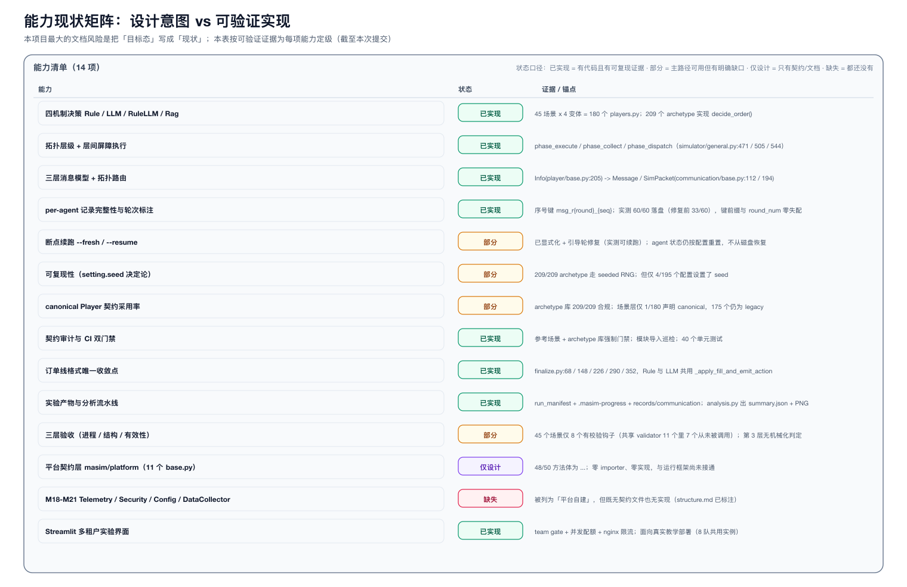

# MASim 设计总纲（Design Principles）

> 本文回答一个问题：**为什么这个框架是现在这个样子**。
> 它不描述目录结构，也不重复 Player 的逐条契约——那两件事各有归属。

## 0. 文档分工（避免"多份权威"）

| 文档 | 回答的问题 | 不含 |
|------|-----------|------|
| **本文 `docs/design/README.md`** | 为什么这样设计？有哪些原则与取舍？ | 目录清单、接口签名 |
| [`docs/design/architecture.md`](architecture.md) | 架构与运行时的**细节**：一轮怎么跑、消息怎么走、状态怎么存（含全部图） | 设计动机 |
| [`docs/structure.md`](../structure.md) | 仓库的**地图**：目录、模块、场景、配置、命令（现状 vs 目标） | 设计原理 |
| [`docs/framework-contract.md`](../framework-contract.md) | Player 的**逐条契约**：扩展点、线格式、审计项、迁移步骤 | 全局架构 |
| [`docs/hybrid-design/`](../hybrid-design/README.md) | **演进设计**：契约层与领域无关平台的 D1–D10 决策 | 现有实现细节 |

约定：本文出现的每一个数字与锚点都可在仓库中复核；**「现状」与「目标」分开标注**（见 §5）。

---

## 1. 定位与设计目标

MASim 让大量异构 agent 在共享世界里**持续感知、决策、行动、通信**，用于观察个体行为如何涌现出宏观结果（价格、波动、流动性、信息传播）。

设计目标按优先级排序：

1. **可复现**：同一份配置 + 同一个 seed → 同一批结果。
2. **可归因**：每个宏观结论都能追到具体 agent 的决策记录。
3. **异构并存**：微秒级规则 agent 与秒级 LLM agent 在同一次运行中协作。
4. **可规模化**：从 11 个 agent（教学 demo）到 10⁵ 个 agent（研究目标）用同一套抽象。
5. **领域无关的内核**：平台只做机制，金融/社会由使用者实现（见 §2 P5）。

第 1、2 条是**研究工具的生命线**——它们决定了任何设计取舍的优先级：宁可中断运行，也不要静默污染数据。

---

## 2. 八条核心设计原则

图：[`design-principles.png`](diagrams/design-principles.png)

### P1 · 行为契约优先（Player 由输出定义）

**原则**：Player 的本质是"能产出 `Action`"，不是"拥有某些能力组件"。任何 agent——包括协调者——都是 Player，区别只是 `role` 与拓扑位置。

**为什么**：如果按"能力"分类 agent（trader / market / observer），每加一种能力就要加一层继承；按"输出"分类则只有一种契约，协调者退化为 `role: coordinator` + 不同的拓扑边。

**落点**：[`masim/player/base.py:114`](../../masim/player/base.py#L114)（`Action`）、[:205](../../masim/player/base.py#L205)（`Info`）、[:482](../../masim/player/base.py#L482)（`BasePlayer`）；四种 canonical 基类在 [`masim/agents/_base.py:430`](../../masim/agents/_base.py#L430)。

**代价**：统一的 `perceive → decide → act` 对"复合 agent / 组织"表达力不足——这正是 Part 2 要用 `AgentRuntime.children()/aggregate()` 补的洞。

### P2 · 三层抽象：Player / Persona / Proxy

**原则**：**Player = 做什么**（纯领域逻辑，隐藏）；**Persona = 何时**（Simulator 唯一接口，Ray actor 边界）；**Proxy = 如何**（消息、存储、观测等基础设施）。

**为什么**：把基础设施从领域逻辑里彻底剥离后，Player 可以脱离 Ray 单独构造与测试；反过来，Ray 的序列化/生命周期问题不会渗进策略代码。

**落点**：[`masim/persona/general.py:95`](../../masim/persona/general.py#L95)（`PlayerPersona`）、[`masim/proxy/general.py:60`](../../masim/proxy/general.py#L60)（`SendReceiveProxy`）/ [:205](../../masim/proxy/general.py#L205)（`StorageProxy`）。

**代价与偏差**：Simulator 仍然 `import PlayerConfig` 并反射 `PARAM_SPECS` 做参数预检——这是**刻意的实用主义**（在创建 Ray actor 之前就失败，比运行中途炸掉便宜得多）。纯粹的"零知识"不成立，但收益更大。

### P3 · 拓扑即顺序（topology.yml 是唯一的顺序与方向来源）

**原则**：谁先执行、谁能给谁发消息，全部由 `topology.yml` 的显式有向边决定；执行顺序 = 拓扑的 BFS 分层（层内并行、层间屏障）。

**为什么**：隐式的"广播给所有邻居"在 10² 规模还能用，到 10⁴ 就变成 O(N²) 且不可解释。显式边让投递量、依赖关系、复现性都可推导。

**落点**：[`masim/utils/topology.py:27`](../../masim/utils/topology.py#L27)，分层在 [:133](../../masim/utils/topology.py#L133)；每个 actor 只收到**自己的** targets/senders 切片（而不是整张图）。

**代价**：新增交互必须改 YAML；同层边与反馈边需要自定义就绪逻辑（见 architecture.md §3）。

### P4 · 逻辑时间，不模拟墙钟

**原则**：时间是 `round / level / step`，不是秒。一轮之内按层同步推进，层间是硬屏障。

**为什么**：LLM 延迟方差极大，若用真实时间就会让"谁先看到谁"变得不可复现。逻辑时间让"同轮同层并行、跨层有序"成为可复现的语义。

**落点**：`ExecutionClock` / `RoundPhase`（[`masim/simulator/base.py`](../../masim/simulator/base.py)）、轮循环 [`masim/simulator/general.py:608`](../../masim/simulator/general.py#L608)。

**代价**：整轮被最慢的 agent 拖住（Amdahl）。异步/降级**是使用者的策略**，平台只提供接口（决策 D6）——因为"旧意图能不能用"是领域问题。

### P5 · 单一契约层：`base.py` 只定义不实现

**原则**：`masim/platform/*/base.py` 只允许 ABC + `@abstractmethod` + dataclass + 类型标注 + 文档；方法体为 `...`。改 base = 改契约，必须走决策记录。

**为什么**：契约与实现分离后，"平台要长成什么" 这件事可以被独立评审，而不被现有实现绑架；同时避免"实现继承实现"的继承爆炸。

**落点**：[`masim/platform/`](../../masim/platform) 11 个契约包；规则见 [`docs/hybrid-design/FRAMEWORK-IMPLEMENTATION-RULE.md`](../hybrid-design/FRAMEWORK-IMPLEMENTATION-RULE.md)。实测 48/50 个方法体为 `...`（2 处例外：`on_fill` 默认空实现、`IsolationKey.scope()` 是格式化逻辑）。

**代价**：目前是**并行宇宙**——契约层零 importer、零实现（见 §5）。写契约的收益在实现接通前是潜在的。

### P6 · 唯一线格式收敛点

**原则**：`clip → validate → emit` 只允许有一个实现：`masim/format/finalize.py`。Rule 与 LLM 的差异被压缩成"分类参数"，而不是两份代码。

**为什么**：下单语义（非 HOLD 必须正价、按现金/持仓裁剪、现金与仓位恰好变更一次）只要有两份实现，就一定会漂移；而漂移在这类框架里表现为**静默的记账错误**。

**落点**：[`masim/format/finalize.py:68/148/226/290/352`](../../masim/format/finalize.py#L68)；Rule 与 LLM 的 `act()` 共用 [`masim/agents/_base.py:332`](../../masim/agents/_base.py#L332) 的 `_apply_fill_and_emit_action()`。

**代价**：类之间的差异被"参数化"了，读单个场景时不如手写直白；换来的是语义不可能分叉。

### P7 · 失败即报错（fail-loud，禁止静默降级）

**原则**：配置错误、语义违约、拓扑异常一律立刻抛错：

| 违约情形 | 行为 | 落点 |
|---|---|---|
| 非 HOLD 单 `bid_price <= 0` | `ValueError` | `require_positive_bid_price()` |
| 收件人不在拓扑里 | 抛错，不静默丢弃 | `encode_and_deliver()` |
| LLM 调用失败（非瞬时） | 向上抛，**不伪造 hold** | `CanonicalLLMPlayer.decide()` |
| 就绪条件不满足 | `RuntimeError` 中断本轮 | `PlayerPersona.operate()` |
| `record_path` 已有数据但没说要续跑 | 拒绝启动 | `GeneralSimulator.run()` |

**为什么**：这是研究工具。静默降级会让一整批实验的结论无法归因，而"跑完了"的假象比"跑挂了"危险得多。**进程 SUCCESS ≠ 结果有效**。

**代价**：一次配置失误会中断长跑（例如 200 轮跑了 3 小时后崩）。缓解手段是把校验前移：pydantic 边界校验 + archetype 参数预检（在创建 actor 之前）。

### P8 · 可复现优先

**原则**：`setting.seed` 是唯一随机性来源；每个 agent 从 `derive_rng(seed, salt=identity)` 得到**自己的**加盐随机流；运行产物自带 provenance。

**为什么**：随机流若共享，agent 之间就有隐式耦合（A 多抽一次随机数会改变 B 的行为），且无法并行复现。加盐保证"同 seed + 同配置 → 逐位一致"。

**落点**：[`masim/utils/rng.py:21`](../../masim/utils/rng.py#L21)、`SeededRngMixin`（[`masim/agents/_base.py:406`](../../masim/agents/_base.py#L406)）、`run_manifest.json`（记录 seed / 轮数 / git commit / player 类清单）、原子 checkpoint（[`resume_scanner.py:158`](../../masim/simulator/resume_scanner.py#L158)）。

**代价**：全局 `random` 被禁用（唯一例外：LLM API key 轮换，它不应消耗仿真随机流）；未设 `seed` 的运行仍然不确定——**目前 195 个配置里只有 4 个设了 seed**（§6 缺口 G2）。

---

## 3. 一条工程原则（本轮新增）

### P9 · 声明必须可验证（documentation-as-claim）

**原则**：文档里的每个断言都要有**锚点**（文件/行）和**状态口径**（现状 / 部分 / 仅设计 / 缺失）；能机械化的断言就交给 CI。

**为什么**：本项目此前最大的风险不是代码 bug，而是**文档把目标态写成现状**——例如"45 场景已迁移 canonical 契约"（实际 1/180）、"框架统一收敛在 `_apply_fill_and_emit_action`"（实际 175/180 场景自己实现了 `act()`）、被引用 5 次却并不存在的 `docs/framework-contract.md`。这类偏差会直接污染技术选型判断。

**落点**：能力矩阵（§5）、[`scripts/audit_scenario_contract.py`](../../scripts/audit_scenario_contract.py) 的迁移进度表、[`scripts/check_module_imports.py`](../../scripts/check_module_imports.py)、CI 双门禁。

**代价**：维护成本（数字会过期），所以凡是能自动生成的数字一律自动打印，而不是手写进正文。

---

## 4. 关键取舍（我们选了什么，放弃了什么）

| # | 选择 | 放弃了什么 | 什么时候会后悔 |
|---|---|---|---|
| T1 | 显式拓扑替代隐式广播 | 快速原型时的"随手发消息" | 需要 10⁵ 全连接交互（Part 2 的 hub/兴趣路由要补） |
| T2 | 逻辑时间 + 层间硬屏障 | 真实时间语义、异步流水线 | 慢 LLM 成为整轮瓶颈时（需要 D6 的 deadline/降级策略） |
| T3 | fail-loud 而非 fail-soft | 长跑的鲁棒性 | 生产级无人值守长跑（需要 checkpoint + 自动续跑，而续跑目前不恢复 agent 状态） |
| T4 | 契约层先行（只定义不实现） | 短期交付速度 | 契约长期不接通 → 变成"文档负债" |
| T5 | 唯一线格式收敛点 | 单场景的写法自由度 | 领域需要全新订单类型时（需扩 `finalize.py` 的分类） |
| T6 | 每 agent 独立随机流 | 跨 agent 的随机相关性（有些模型需要） | 需要"群体共同冲击"时（应显式建模为共享信号，而不是共享 RNG） |
| T7 | archetype 库与场景解耦 | 场景作者"就地改一行"的便利 | 场景需要 archetype 之外的特殊行为时（应新增 archetype，而不是 fork 场景代码） |

---

## 5. 能力现状矩阵

矩阵的读法（四档状态）：

- **已实现** —— 有代码，且有可复现证据（测试 / 实测 / 审计输出）。
- **部分** —— 主路径可用，但有明确缺口（缺口写在 §6）。
- **仅设计** —— 只有契约或文档，没有任何实现路径接通。
- **缺失** —— 连契约都没有。

三个最容易被误读的结论：

1. **canonical 契约在场景层的采用率是 1/180**（另 4 个是合规的"组合式"薄模块，175 个仍是 legacy）。archetype 库则是 209/209 合规——**库层干净，场景层未迁移**。
2. **平台契约层（`masim/platform/`）是"仅设计"**：11 个契约文件、零 importer。它描述的是目标，不是现状。
3. **三层验收几乎没有机械化**。共享校验模块里有 11 个场景专用 validator，但只有 **4 个真的被调用**（AssetBubble / DispositionEffect / EquityPremium / FlashCrash / FlashCrash2010 五个变体），**7 个是死代码**；另 6 个场景自己写了本地 `validate_*`。合计 **45 个场景里只有 8 个有任何校验钩子，37 个完全没有**；第 3 层「机制是否复现」没有任何机械化判定。

---

## 6. 已知缺口与优先级

| # | 缺口 | 影响 | 建议动作 |
|---|---|---|---|
| G1 | 175 个 legacy 场景（74.6k LOC，其中 46% 在 `perceive/decide/act` 内） | 契约无法强制；修一个 bug 要改 175 处；审计的 STRUCT 检查对它们空转 | 先迁移 3–5 个代表场景，把 CI 门禁从 1 个扩到 6 个 |
| G2 | 195 个配置只有 4 个设 `setting.seed` | 可复现性（P8）对绝大多数实验未生效 | 模板里默认写上 seed；`run()` 对缺失 seed 给出警告 |
| G3 | 续跑不恢复 agent 状态 | `--resume` 只对"剩余轮次不依赖当前状态"的运行安全 | 实现 `save_state/load_state` 的接线（框架已有方法，无调用者） |
| G4 | archetype 代码骨架重复（结构重复率 93%，`init_extras` 200 份定义只有 19 种实现） | 改一处默认值要改 73 处；`PARAM_SPECS` 仅 10/209 → 参数校验基本空转 | 声明式 `PARAMS` 参数表 + 基类通用 `init_extras` |
| G5 | `masim/platform/` 零 importer、M18–M21 无契约 | 交付物与运行框架脱节 | 要么接通（D7 最小改造），要么在文档中降级为"提案" |
| G6 | 三层验收第 3 层无机械化判定 | "进程成功"被误当成"场景有效" | 把 `analysis-bases.md` 的判据变成可执行断言 |
| G7 | 复合 agent / 共享世界状态 / Registry / ScalePolicy 仅设计 | 无法表达组织、群体、公司等主体 | 按 D2/D10 先落一个最小 `CompositeOrchestrator` |

---

## 7. 术语表

| 术语 | 含义 | 锚点 |
|------|------|------|
| Player | 领域逻辑单元，`perceive → decide → act` | `masim/player/base.py` |
| Persona | Player 的基础设施外壳 + Ray actor 边界 | `masim/persona/general.py:95` |
| Proxy | 消息 / 存储 / 观测基础设施代理 | `masim/proxy/general.py` |
| Level | 拓扑 BFS 分层，层内并行、层间屏障 | `masim/utils/topology.py:133` |
| Round | 一次完整的层级遍历 | `masim/simulator/general.py:608` |
| Bootstrap round | 本次进程执行的**第一轮**；level 0 免于等待前驱 | `masim/player/general.py:275` |
| Canonical base | 四种契约基类（Rule/LLM/RAG/MarketCoordinator） | `masim/agents/_base.py` |
| Archetype | 可复用 agent 实现（209 个），与 `defines/*.md` 档案 1:1 | `masim/agents/{finance,market,opinion}` |
| Mechanism | 决策机制：Rule / LLM / RuleLLM / Rag | `configs/{Scenario}/{Mechanism}` |
| Variant | 一个场景 × 一个机制 = 一个 `players.py` | `examples/{Scenario}/{Mechanism}` |
| Wire format | `Info → Message → SimPacket` 的编码结果 | `masim/communication/` |
| `record_path` | 一次运行的输出根目录，是产物路径的唯一来源 | `configs/*/simulation.yml` |

---

## 8. 推荐阅读路径

1. **先看三张图**：本文的能力矩阵 → [`architecture-layers.png`](diagrams/architecture-layers.png) → [`round-execution-flow.png`](diagrams/round-execution-flow.png)
2. **想改代码**：读 [`architecture.md`](architecture.md) 的对应小节 + [`framework-contract.md`](../framework-contract.md)
3. **想做场景**：[`docs/structure.md`](../structure.md) §5–§8 + `masim/skills/create-simulation-pipeline.md`
4. **想推进平台演进**：[`docs/hybrid-design/`](../hybrid-design/README.md) + [`hybrid_design_comparison/`](../hybrid_design_comparison/MAF_MASIM_design_comparison.md)
