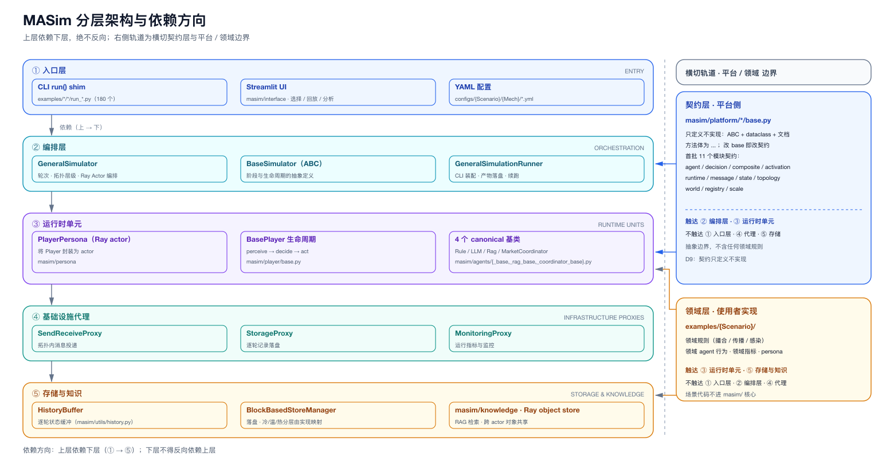
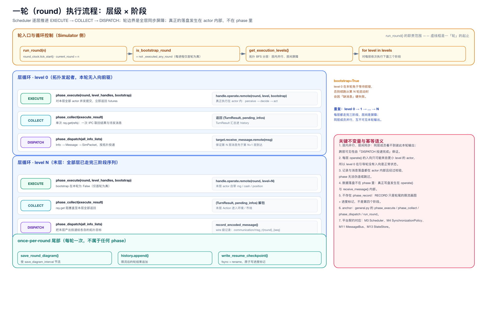
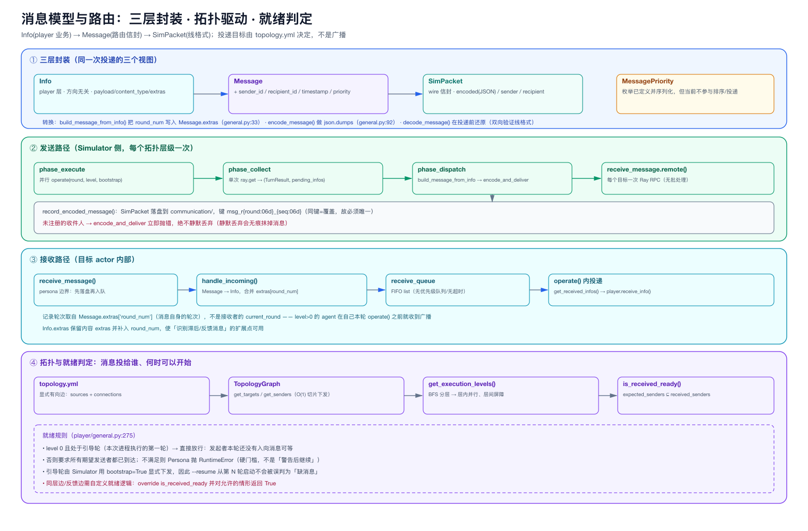
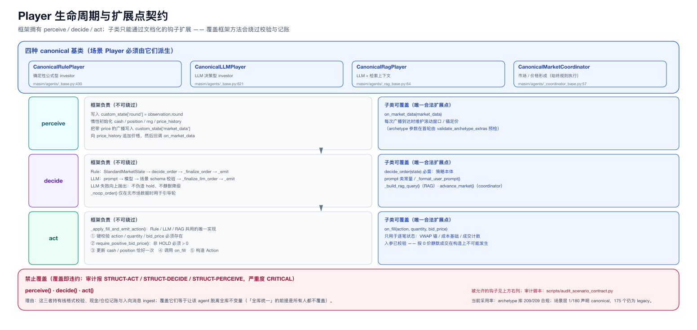
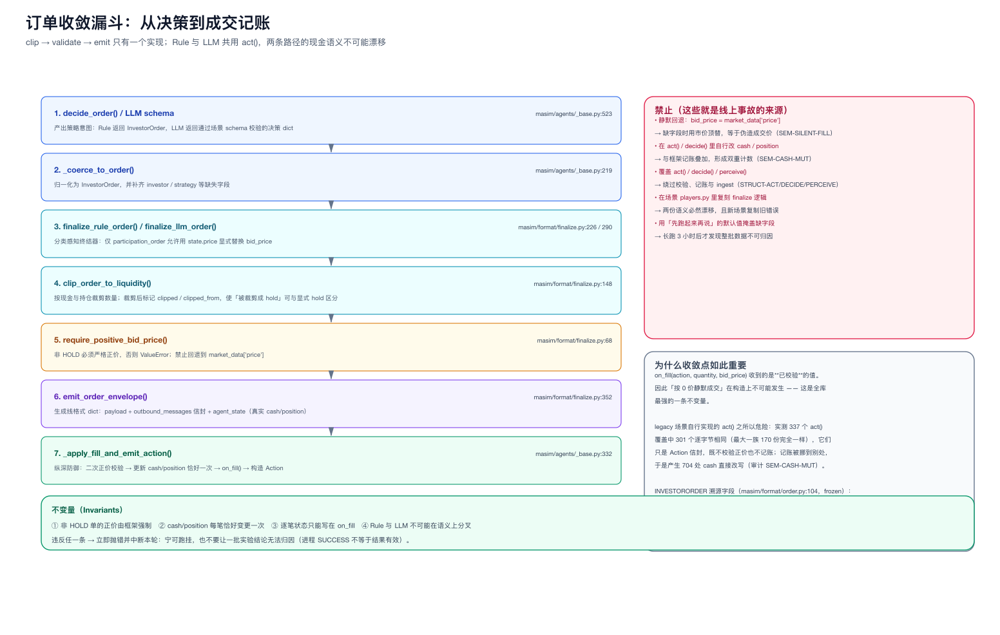
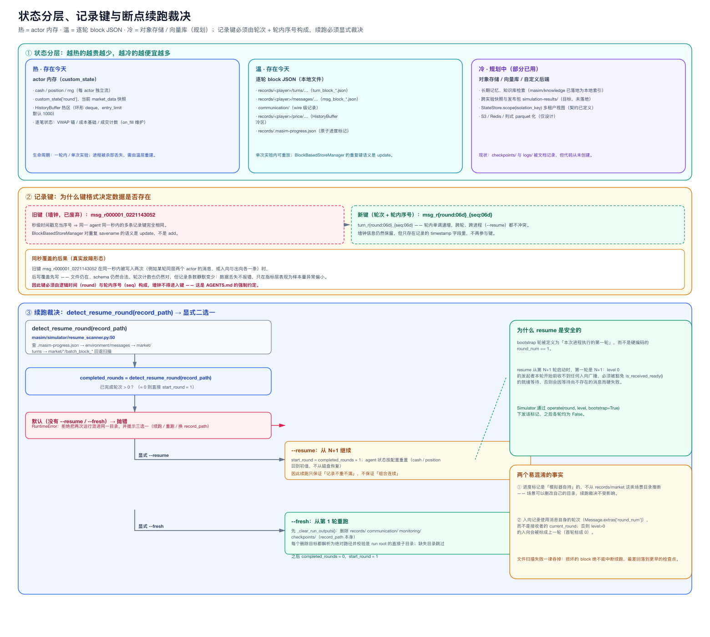
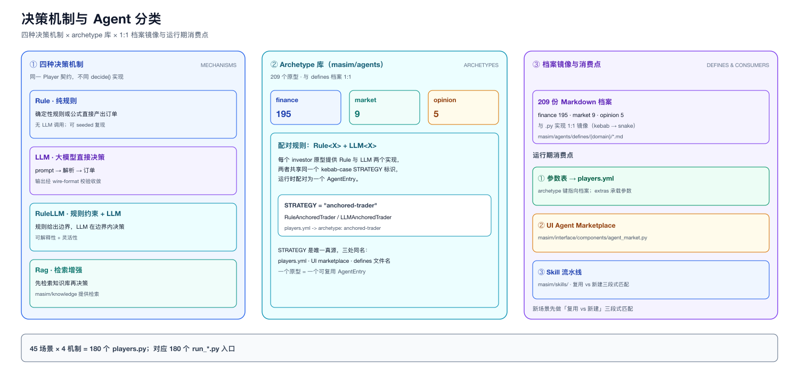
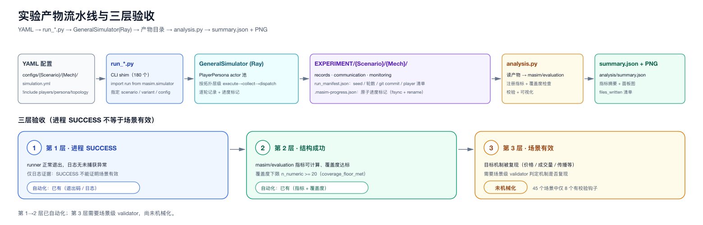
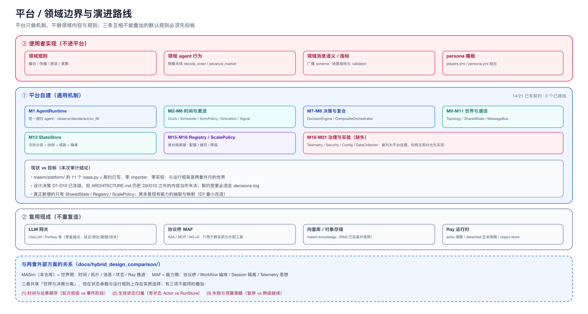

# MASim 架构与运行时细节

> 本文是 [`README.md`](README.md)（设计原则）的**细节配套**：一轮怎么跑、消息怎么走、状态怎么存、契约怎么落地。
> 每个小节都配图，并给出可直接复核的代码锚点。

## 目录

1. [分层架构](#1-分层架构)
2. [一次运行的完整生命周期](#2-一次运行的完整生命周期)
3. [一轮（round）的执行流程](#3-一轮round的执行流程)
4. [消息模型与路由](#4-消息模型与路由)
5. [Player 生命周期与契约](#5-player-生命周期与契约)
6. [订单收敛漏斗](#6-订单收敛漏斗)
7. [拓扑与就绪判定](#7-拓扑与就绪判定)
8. [状态、记录键与断点续跑](#8-状态记录键与断点续跑)
9. [配置系统](#9-配置系统)
10. [Agent 分类与 archetype 库](#10-agent-分类与-archetype-库)
11. [实验产物流水线与三层验收](#11-实验产物流水线与三层验收)
12. [平台 / 领域边界与演进](#12-平台--领域边界与演进)
13. [运行与调试速查](#13-运行与调试速查)
14. [已知的架构偏差](#14-已知的架构偏差)

---

## 1. 分层架构



**依赖方向是单向的**（上层依赖下层，下层不知道上层）：入口层 → 编排层 → 运行时单元 → 基础设施代理 → 存储。

| 层 | 组成 | 关键锚点 | 职责边界 |
|---|---|---|---|
| ① 入口层 | `examples/*/*/run_*.py` shim、Streamlit UI、`configs/*.yml` | [`masim/simulator/general.py`](../../masim/simulator/general.py) 的 `run()` | 解析参数、加载并校验配置、打印 banner |
| ② 编排层 | `GeneralSimulator` / `BaseSimulator` / `GeneralSimulationRunner` | [:188](../../masim/simulator/general.py#L188) / [`base.py`](../../masim/simulator/base.py) | 创建 actor、推进轮次、层级调度、收尾 |
| ③ 运行时单元 | `PlayerPersona`(Ray actor) → `BasePlayer` + 4 个 canonical 基类 | [`persona/general.py:95`](../../masim/persona/general.py#L95) / [`agents/_base.py:430`](../../masim/agents/_base.py#L430) | 一轮之内：校验就绪 → 投递入向 Info → 执行 `turn()` |
| ④ 基础设施代理 | `SendReceiveProxy` / `StorageProxy` / `MonitoringProxy` | [`proxy/general.py:60`](../../masim/proxy/general.py#L60) / [:205](../../masim/proxy/general.py#L205) | 队列与就绪状态、落盘、指标 |
| ⑤ 存储与知识 | `HistoryBuffer` + `BlockBasedStoreManager`、`masim/knowledge`、Ray object store | [`utils/history.py`](../../masim/utils/history.py)、[`utils/store_backend.py`](../../masim/utils/store_backend.py) | 热/温/冷分层持久化、RAG 检索 |

**两条横切**：

- **契约层** `masim/platform/*/base.py`：只定义不实现，语义上约束 ②③，目前**零 importer**（见 §12）。
- **领域层** `examples/{Scenario}`：通过配置（`players.yml` 的 `class:`）与 archetype 库挂到 ③，通过 `analysis.py` 读 ⑤。

**为什么 Simulator 只持有 handle**：拓扑切片下发（每个 actor 只拿到自己的 `targets/senders` 与目标 handle）把 setup 的 IPC 从 O(N²) 降到 O(Σ(targets+senders))，这是 10³ 规模下最划算的一处优化。

---

## 2. 一次运行的完整生命周期

```text
CLI/UI → load_config(!include + ${VAR}) → pydantic 边界校验 → SimulationConfig
      → GeneralSimulator.__init__（建通信通道）
      → setup(): ensure_ray → TopologyGraph → 创建 N 个 detached actor
                 → 并发 initialize() → 下发拓扑切片 + peer handles → 画 round 0 图
      → run(): 续跑裁决 → 写 run_manifest.json → for round in start..total:
                   update_topology(round) → for level in BFS levels:
                        EXECUTE → COLLECT → DISPATCH
                   RECORD（限流画图）→ history.append → 原子写 progress 标记
      → 停止：所有 actor shutdown → ray.kill → ray.shutdown（带 GCS 健康检查）
```

两个容易忽略的点：

1. **`setup()` 是并发的**：`initialize()`、`set_topology()`、`set_peer_handles()` 各自批量提交后用单次 `ray.get` 收敛，不是 N 次串行 RPC。
2. **收尾是防御性的**：先尝试优雅 `shutdown`，再 `ray.kill`；如果本地 GCS 已死，则跳过远程清理以避免 Ray 重连超时（Windows 上会导致 native access violation）。

---

## 3. 一轮（round）的执行流程



一轮 = **对拓扑每个层级跑三个阶段的循环** + **一次轮尾记录**。

| 阶段 | 方法 | 做什么 | 锚点 |
|---|---|---|---|
| EXECUTE | `phase_execute` | 对本层所有 actor 并发提交 `operate(round, level, bootstrap)`；立即返回 futures | [:471](../../masim/simulator/general.py#L471) |
| COLLECT | `phase_collect` | **单次** `ray.get(refs)` 收齐 `(TurnResult, pending_infos)` | [:505](../../masim/simulator/general.py#L505) |
| DISPATCH | `phase_dispatch` | `build_message_from_info` → `encode_and_deliver` → 目标 actor `receive_message`，再单次 `ray.get` 等投递完成 | [:544](../../masim/simulator/general.py#L544) |
| RECORD（轮尾，非 phase 方法） | — | 限流画拓扑图 + `history.append` + 原子写 `.masim-progress.json` | [:608](../../masim/simulator/general.py#L608) |

**关键语义**：

- **屏障在层与层之间**：第 N 层的 DISPATCH 全部完成后，第 N+1 层才开始 EXECUTE。这是"先发后收"可复现的根据。
- **数据落盘不在 phase 里**：真正的记录发生在 `operate()`（turn 记录）与 `receive_message()`（入向消息记录）内部。
- **`bootstrap` 只对本次进程的第一轮为真**：它让 level 0 的发起者不必等待"本轮还不存在的入向消息"。这一条同时保证了正常启动与 `--resume` 都能跑起来。
- **无 `ray.wait`、无 placement group、无消息批处理**：当前是每目标一次 RPC；规模化的第一优化点就在这里。

---

## 4. 消息模型与路由



同一次投递有三个视图：

| 层 | 类型 | 承载 | 锚点 |
|---|---|---|---|
| Player | `Info` | 业务内容：`payload` / `content_type` / `extras`；方向无关 | [`player/base.py:205`](../../masim/player/base.py#L205) |
| Channel | `Message` | 路由信封：`sender_id` / `recipient_id` / `timestamp` / `priority` / `extras` | [`communication/base.py:112`](../../masim/communication/base.py#L112) |
| Wire | `SimPacket` | 线格式：`encoded`(JSON) + 收发者，可记录可传输 | [`communication/base.py:194`](../../masim/communication/base.py#L194) |

**转换只在一处**：[`build_message_from_info()`](../../masim/communication/general.py#L33) 把 Info 包成 `{content, content_type, extras}` 信封，并把 `round_num` 写入 `Message.extras`。

**投递是"按目标复制"，不是广播**：Simulator 遍历发送者的 `targets` 列表，为每个目标生成一条 Message。

**接收侧的三个约定**：

1. 先落盘再入队（`record_message` → `handle_incoming`）。
2. `handle_incoming` 把 `Message` 还原成 `Info`，并把 `round_num` 合并进 `Info.extras`——这使"识别滞后/反馈消息"成为可能。
3. 入向记录使用**消息自身的轮次**。level > 0 的 agent 在自己本轮 `operate()` 之前就收到广播，若用接收者的 `current_round` 会产生错位（首轮甚至记为 round 0）。

**当前的能力边界**（诚实清单）：`MessagePriority` 已定义并序列化，但不参与排序/投递；没有延迟、超时、优先级队列或队列上限；`message_timeout_ms` / `enable_compression` / `max_message_size_bytes` 等配置字段声明了但未被读取。

---

## 5. Player 生命周期与契约



```text
operate(round, level, bootstrap)
  ├─ 就绪检查  is_received_ready(round, received_senders, level, bootstrap)
  │     False → RuntimeError（硬门槛）
  ├─ 投递入向 Info：proxy.get_received_infos() → player.receive_info()
  └─ turn() → for _ in range(steps_per_turn): step()
        perceive → decide → act
```

**谁拥有什么**（完整契约见 [`docs/framework-contract.md`](../framework-contract.md)）：

| 阶段 | 框架负责 | 子类可覆盖（唯一合法扩展点） |
|---|---|---|
| `perceive` | 写 `round`；惰性初始化 `cash/position/rng/price_history`；把带 `price` 的广播写入 `market_data` 并追加历史 | `on_market_data(market_data)` |
| `decide` | Rule：`StandardMarketState → decide_order → _finalize_order → _emit`；LLM：prompt → 模型 → schema 校验 → `_finalize_llm_order → _emit` | `decide_order(state)`（必需）、prompt 常量、`_format_user_prompt()`、`_build_rag_query()`、`advance_market()` |
| `act` | `_apply_fill_and_emit_action()`：键校验 → 正价校验 → 更新 cash/position → `on_fill` → `Action` | 仅 `on_fill(action, quantity, bid_price)` |
| **禁止** | — | `perceive()` / `decide()` / `act()`：覆盖会绕过校验与记账，审计报 STRUCT-* (CRITICAL) |

**四种 canonical 基类**：

| 基类 | 锚点 | 用途 |
|---|---|---|
| `CanonicalRulePlayer` | [`_base.py:430`](../../masim/agents/_base.py#L430) | 确定性公式型 investor |
| `CanonicalLLMPlayer` | [`_base.py:621`](../../masim/agents/_base.py#L621) | LLM 决策型 investor |
| `CanonicalRagPlayer` | [`_rag_base.py:64`](../../masim/agents/_rag_base.py#L64) | LLM + 检索上下文 |
| `CanonicalMarketCoordinator` | [`_coordinator_base.py:57`](../../masim/agents/_coordinator_base.py#L57) | 市场/价格形成协调者（始终规则执行） |

**方向是反转的**：investor 消费广播、产出订单；coordinator 消费订单、产出广播。

---

## 6. 订单收敛漏斗



```text
decide_order() / LLM schema
   → _coerce_to_order()            归一化为 InvestorOrder
   → finalize_rule_order() / finalize_llm_order()   分类感知的终结器
   → clip_order_to_liquidity()     按现金/持仓裁剪，并标记 clipped/clipped_from
   → require_positive_bid_price()  非 HOLD 必须 > 0，否则 ValueError
   → emit_order_envelope()         线格式 + outbound_messages + agent_state
   → _apply_fill_and_emit_action() 二次防御校验 → cash/position 恰好变更一次 → on_fill → Action
```

**这一条链是框架最重要的不变量**：`on_fill` 拿到的是**已校验**的 `(action, quantity, bid_price)`，因此"按 0 价静默成交"在构造上不可能发生。Rule 与 LLM 共用同一个 `act()` 实现，两条路径的现金语义不可能漂移。

### 6.1 执行 / 结算接缝（机制与策略分离）

成交**规则**不再硬编码在 agent 里，而是通过一个可插拔的接口注入：

```text
agent.act()
  → OrderIntent（请求：action / quantity / bid_price，不改状态）
  → agent.fill_model.execute([intent], MarketView)      ← 策略，可替换
  → Fill（成交回报：fill_price / fill_quantity，权威值）
  → Portfolio.apply_fill(fill)                          ← 唯一的账本变更入口
  → on_fill(fill.action, fill.fill_quantity, fill.fill_price)
```

| 归平台（机制） | 归领域（策略） |
|---|---|
| `FillModel` 是订单变成成交的**唯一**通道；一笔订单恰好一份回报 | 成交价/量怎么算（市价、统一清算价、订单簿、滑点模型） |
| `Portfolio.apply_fill()` 是 cash/position 的**唯一**变更入口 | 能否部分成交、排队规则、优先规则、手续费 |
| 非零成交量的成交价必须 > 0（三层校验） | 市场深度与冲击模型 |
| 回报可追溯（`model` 字段）+ 可快照 | 对手方选择 |

**默认策略 `SelfFillModel` 与历史行为逐位一致**（成交价 = 报价、全额成交），因此既有实验不受影响；`extras.fill_model` 可指向 `"module:Class"`，或在 archetype 上覆盖 `FILL_MODEL` 类属性。

**为什么重要**：旧实现把一条**策略**（自成交）当成了机制，且市场协调者从不读 `bid_price`（只聚合数量），于是成交价与市价可以无限背离——实测平均 1.14%、最大 4.5%，且**按策略类型系统性偏移**（动量总是高于市价买入、逆势总是低于市价卖出）。所有基于 PnL 的指标都继承了这个偏差，而微观结构类场景在该平台上根本无法表达。接缝落地后，两者都变成"换一个策略"。

**仍未做**（刻意）：延迟结算（市场在下一轮才回报）、订单簿/排队模型。接缝让这两件事变成**加法**而不是重写。

**`InvestorOrder` 带溯源字段**（`masim/format/order.py:104`，frozen dataclass）：`skipped/skipped_reason`、`clipped/clipped_from/clipped_intended_quantity/clipped_reason`，使"被裁剪成 hold"与"显式 hold"在指标层可区分——这是行为指标可信的前提。

---

## 7. 拓扑与就绪判定

| 概念 | 实现 | 锚点 |
|---|---|---|
| 拓扑定义 | `topology.yml` 的 `sources` + `connections`（显式有向边） | `configs/*/topology.yml` |
| 邻接查询 | `get_targets()` / `get_senders()` | [`topology.py:83/97`](../../masim/utils/topology.py#L83) |
| 执行分层 | `get_execution_levels()`（BFS） | [:133](../../masim/utils/topology.py#L133) |
| 就绪判定 | `is_received_ready(round, received_senders, level, bootstrap)` | [`player/general.py:275`](../../masim/player/general.py#L275) |
| 强制点 | `PlayerPersona.operate()` 返回 False 即抛 `RuntimeError` | [`persona/general.py:233`](../../masim/persona/general.py#L233) |

**规则**：

1. level 0 且处于**引导轮**（本次进程执行的第一轮）→ 直接放行；
2. 无期望发送者 → 放行；
3. 否则要求 `expected_senders ⊆ received_senders`。

**为什么 `bootstrap` 必须存在**：原本的豁免硬编码为 `round_num == 1`，于是续跑（从第 N 轮开始）时 level 0 会要求等待本轮尚未产生的消息而中断。现在由 Simulator 显式下发"这是本进程第一轮"。

**同层边与反馈边**：默认规则对它们不成立（同层发送者的消息按设计是"落后一轮"的），需要 override `is_received_ready`，并对允许的情形返回 `True`——注意它返回 `False` 会**中断运行**，不是"警告后继续"。

---

## 8. 状态、记录键与断点续跑



### 8.1 三层状态

| 层 | 内容 | 载体 | 现状 |
|---|---|---|---|
| 热 | `custom_state`（cash/position/rng/价格历史窗口） | actor 内存 + `HistoryBuffer` 热区 deque | 已实现 |
| 温 | 逐轮记录：`records/<player>/{turns,messages}/`、`communication/`、`monitoring/` | `BlockBasedStoreManager` 分块 JSON | 已实现 |
| 冷 | 长期记忆、向量库、快照 | 对象存储 / `masim/knowledge` | 部分（RAG 索引已用于检索；快照未实现） |

### 8.2 记录键为什么必须唯一

`BlockBasedStoreManager` 用 `savename` 作为 block JSON 的 **key**，重复 key 的语义是 **update 而不是 add**。旧实现用秒级墙钟键（`msg_r000001_0221143052`），于是同一 agent 在同一秒内的多条入向记录互相覆盖——实测一次 3 轮运行中：投递 60 条只落盘 33 条，协调者 30 条只落 1 条。

现在统一为：`msg_r{round:06d}_{seq:06d}` / `turn_r{round:06d}_{seq:06d}`（轮内序号，跨进程唯一）。**修复后实测 60/60 全量落盘。**

### 8.3 断点续跑裁决

```text
detect_resume_round(record_path)   # 优先读 .masim-progress.json，其次环境消息/轮次块
        │
        ├─ 已完成轮次 == 0 ──────────────→ 从第 1 轮开始
        └─ 已完成轮次 N > 0
              ├─ 无参数 ──→ 抛错并给出三个选项（拒绝静默混数据）
              ├─ --resume → 从 N+1 继续；agent 状态按配置重置（不从磁盘恢复）
              └─ --fresh  → 删除 records/ communication/ monitoring/ checkpoints/ 后从 1 开始
```

`.masim-progress.json` 用 `fsync + os.replace` 原子写，因此崩溃永远不会留下半个标记。

**仍存在的限制**：`save_state/load_state` 在框架里已实现，但**没有任何调用者**，所以续跑不会恢复现金/仓位。因此 `--resume` 只对"剩余轮次不依赖当前组合状态"的运行安全（见 [`GeneralSimulator.run()`](../../masim/simulator/general.py) 的 docstring）。

---

### 8.4 规模化观测（run_metrics）

平台此前**无法测量自己**：`ExecutionClock` 只有整轮总时长，`monitoring/` 因为没有任何代码调用 `MonitoringProxy.shutdown()` 而**永远是空的**，也没有 RPC / 消息 / 内存计数。任何"这就是规模瓶颈"的说法都不可证伪。

现在每轮记录（`masim/simulator/metrics.py`，纯观测、不改变行为）：

| 维度 | 字段 |
|---|---|
| 阶段耗时 | `wall_ms` / `execute_ms` / `collect_ms` / `dispatch_ms`（collect 来自 `ray.get` 实测） |
| RPC 与消息 | `operate_calls` / `messages`（扇出后条数）/ `deliveries`（实际投递 RPC 数）/ `max_fanout` |
| 形状与内存 | `levels` / `agents_active` / `driver_rss_mb` / `object_store_used_mb` |

产物：`monitoring/run_metrics.json`（含 p50/p95/max 汇总），并在运行日志里逐轮打印；`run()` 与 `shutdown()` 都会发布（Streamlit 走的是 `run_round()`，不会经过 `run()`），且发布失败绝不影响仿真。

**首测就以 73% : 2% 定位了瓶颈**：11 agent 的一轮里 dispatch 占 83–89ms，而 agent 自身计算只占 1.2–3.1ms。据此做的按收件人批量投递把投递 RPC 从 20/轮降到 11/轮、dispatch 降到 40–56ms（详见 §4 Batching 说明）。

同时修掉了两个让观测失真的缺陷：`MonitoringProxy` 的缓冲**从未落盘**（现在由 `PlayerPersona.shutdown()` 统一 flush），以及所有 actor 共用一个 `monitoring/` 目录、用同一种索引键写入，导致 11 个 actor 的记录互相覆盖（现在按 player id 命名空间，与 `records/` 一致）。

### 8.5 共享世界状态（World，带版本提交）

M10 契约（`masim/platform/world/base.py`：`get` / `set` / `version` / `snapshot`）此前**零实现**；现在有了唯一实现 `masim/world/shared_state.py: VersionedSharedState`。

```text
协调者广播（payload 即"它眼中的世界"）
   → world.set(key, value, version=WorldVersion(round, level), scope=<协调者 id>)   ← 暂存
   → world.commit(WorldVersion(round, N))                                          ← 轮末原子发布
   → world/world_state.json（版本 + 作用域 + 变量 + 逐次提交历史）
```

| 语义 | 说明 |
|---|---|
| **暂存 / 提交分离** | `set()` 只暂存；`commit()` 在**轮末一次发布**，因此读到的永远是完整版本，不会看到"半应用"的一层 |
| **版本** | `WorldVersion(round_num, level, seq)`；每次有变更的提交进历史（哪些键变了、何时变） |
| **作用域 = 多市场原语** | 键按 `scope.key` 命名空间化：`world.get("price", scope="market_b")`；`world.read_all("price")` 一次读出**所有市场**的同名变量——这正是宏观层跨市场聚合需要的原语 |
| **快照 / 回滚** | `snapshot()` / `restore()`：世界是框架里**第一个能真正回到过去**的部分，也是 resume 恢复世界状态的前提 |

**实测（首次多市场运行）**：同一拓扑内两个独立协调者（fundamental 100 / 60）同时运行，16 个 player，world 产出 **2 个作用域**：`market.price=110.23`、`market_b.price=66.56`，各自独立演化。

**边界（必须说清，否则就是把"目标态"写成"现状"）**：

1. 今天是**驱动侧的投影**——协调者把世界发布到消息里，驱动者再投影进 World；**agent 不能直接读写 World**。要让 agent 直接写（订单簿、共享信息池），需要 World actor（或按 actor 复制的视图），这是下一步。
2. **agent 侧的按来源感知已补齐**：`MarketPerceptionMixin` 把每条市场信号同时记到 `custom_state["market_data_by_source"][sender_id]`（来源取自 `Info.sender_id`），archetype 用 `self.market_data_for("market_b")` 精确取用；`custom_state["market_data"]` 保留为**最后到达者优先的别名**，因此单市场场景与既有 archetype **逐位不变**（seed 42 A/B 已验证）。
3. **仍缺的是"用起来"**：仓库里还没有内置的**多市场场景**，也没有同时读两个市场的 archetype。平台能力已就绪，下一步是拿一个真实的多市场/跨资产场景把它跑成基线。

## 9. 配置系统

`configs/{Scenario}/{Mechanism}/` 四个文件，通过 YAML `!include` 组合：

```text
simulation.yml
  ├─ setting:      name / total_rounds / seed / record_path / save_diagram_interval
  ├─ ray:          namespace / actor_options / object_store_memory / serialization
  ├─ communication: storage_path / record_messages / message_block_size
  ├─ players:      !include players.yml      → 每个 player 的 class / num_instances / config / persona
  ├─ topology:     !include topology.yml     → sources + connections
  └─ knowledge:    （可选）RAG 文档源
```

处理链：`load_config()` 支持 `!include`、`${VAR:-default}` 环境插值、`num_instances` 实例展开（`market_investor` → `rule_x_investor_1..N`）；随后 `validate_simulation_config()` 用 pydantic v2 做边界校验（根级 `extra="forbid"`，并交叉校验 topology 引用的 player 是否存在）。

**两个注意点**：

1. **校验只在入口执行**：CLI `run()` 与 Streamlit runner 会校验；`BaseSimulationRunner.from_config()/execute()` **不校验**——程序化嵌入会绕过。建议嵌入时自行调用 `validate_simulation_config()`。
2. **`setting.record_path` 是产物路径的唯一来源**：`checkpoints/` 与 `monitoring/` 由它派生（`derive_persona_output_paths()`），所以配置里不再重复写这些路径（重复必然会漂移）。

---

## 10. Agent 分类与 archetype 库



**四种机制**（同一场景的四个变体）：

| 机制 | 决策方式 | 是否需要 LLM |
|---|---|---|
| `Rule` | 公式/阈值，`decide_order()` 返回 `InvestorOrder` | 否 |
| `LLM` | prompt → 模型 → 场景 schema 校验 | 是 |
| `RuleLLM` | 规则约束下的 LLM 决策 | 是 |
| `Rag` | LLM + 检索上下文（`_build_rag_query()`） | 是 |

**archetype 库**（`agent_library/`，209 个）：

- `finance/` 195 个 investor、`market/` 9 个价格形成协调者、`opinion/` 5 个信息传播 agent。
- 每个 investor 是 **`Rule<X>` + `LLM<X>` 配对**，共享同一个 kebab-case `STRATEGY` 标识；协调者是单个 `Market<X>`。
- 每个实现与 `agent_library/defines/<domain>/<kebab>.md` 档案**1:1 镜像**（209/209，已用规范化 stem 核对）。
- 档案不是纯文档：`## Parameters` 表会被解析成参数规格，用于生成 `players.yml` 的 `extras` 和 UI 的参数编辑器。

**场景与库的关系**：`examples/{Scenario}/{Mechanism}/players.py` 有两种合法形态——**组合式**（只 re-export archetype，约 60 行，是目标形态）与 **legacy**（自己实现 `perceive/decide/act`）。当前 180 个变体中：1 个声明 canonical、4 个组合式、**175 个 legacy**。

---

## 11. 实验产物流水线与三层验收



```text
run_*.py -c configs/... ─→ 产物目录 ─→ analysis.py ─→ summary.json + PNG
                            ├─ records/<player>/{turns,messages,price,...}
                            ├─ communication/            （wire 级）
                            ├─ monitoring/               （指标/事件）
                            ├─ diagrams/                 （拓扑图，按 interval 限流）
                            ├─ run_manifest.json         （seed / 轮数 / git commit / player 清单）
                            └─ .masim-progress.json      （原子进度标记，续跑依据）
```

读取用 [`masim.utils.load_results()`](../../masim/utils/result_loader.py)；`analysis.py` 是**独立第二步**（`run()` 不会自动调用它）。

**三层验收（重要：不是同一件事）**：

| 层 | 判据 | 现状 |
|---|---|---|
| ① 进程成功 | 日志出现 SUCCESS | 已实现，但**只是必要条件** |
| ② 结构成功 | 指标可计算 + 覆盖度下限（`n_numeric >= 20`）+ validator | **部分**：45 个场景里只有 8 个有校验钩子（4 个调用共享 validator，6 个自带本地 `validate_*`），其余 37 个没有；共享模块的 11 个 validator 中有 7 个从未被调用 |
| ③ 场景有效 | 目标机制真的复现（"羊群"真的出现） | **未机械化**：靠 `analysis-bases.md` 的人工判据 |

**进程 SUCCESS ≠ 场景有效**——这是本项目最容易自欺的一点。

---

## 12. 平台 / 领域边界与演进



三层边界（决策 D3）：**① 平台自建机制** · **② 复用现成**（LLM 网关 / MAF 协议桥 / 向量库 / 对象存储） · **③ 使用者实现领域**。

**契约层现状**（`masim/platform/`，11 个 `base.py`）：

| 事实 | 数字 |
|---|---|
| 契约文件 | 11 |
| 抽象方法体为 `...` | 48/50（例外：`on_fill` 默认空实现、`IsolationKey.scope()` 格式化） |
| 契约层的 importer | **0** |
| 有契约的模块 | M1–M11、M13、M15、M16（14 个 M 编号） |
| 无契约的模块 | M18 Telemetry、M19 Security、M20 Config、M21 DataCollector（被标为"平台自建"却缺失） |
| ② 复用类模块 | M12 ProtocolBridge、M14 KnowledgeStore、M17 LLMGateway（D10 明确不写 base.py） |

**结论**：契约层描述的是**目标架构**，尚未与运行框架接通。推进方式按 D7「最小改造」：Clock 扩展现有 `ExecutionClock`、Scheduler 重构 `run_round`、SyncPolicy 替换 `ray.get`、Activation 挂在 `phase_execute`，而不是重写。

**与外部方案的关系**：MASim = 世界侧（时间/拓扑/消息/状态/Ray），MAF = 能力侧（协议桥/编排/隔离/Telemetry 思想），Muhan 方案 = 另一套竞争终态。三者共享"世界与决策分离"，但有三项规则不能同时叠加：**时间与后果顺序**、**生效状态归属**、**失败与预算策略**。

---

## 13. 运行与调试速查

```bash
# 运行（Rule 变体不需要 API key）
python examples/HerdEffect/Rule/run_herd.py -c configs/HerdEffect/Rule/simulation.yml

# 续跑语义（互斥）
... --resume        # 从已完成轮次 +1 继续（agent 状态按配置重置）
... --fresh         # 清空上一轮产物后从第 1 轮开始
... (无参数 + 已有数据) # 拒绝启动并给出上述三选一提示

# 分析（独立第二步）
python examples/HerdEffect/Rule/analysis.py -c configs/HerdEffect/Rule/simulation.yml

# 界面
streamlit run app/app.py

# 质量门禁
python scripts/check_module_imports.py                       # 真导入（抓签名 NameError）
PYTHONPATH=. python -m unittest discover -s tests -t tests -p "test_*.py"        # 57 单元测试
PYTHONPATH=. python -m unittest discover -s examples/uTests -t . -p "test_*.py"  # 151 按部分验收
python scripts/audit_scenario_contract.py --scope archetypes --no-legacy-info
python scripts/audit_scenario_contract.py --scope scenarios --scenario AnchoringEffect --no-legacy-info
python scripts/check_diagrams.py docs/design/diagrams        # 图布局（文字重叠）

# 规模化观测
cat EXPERIMENT/{Scenario}/{Mech}/monitoring/run_metrics.json | head -40
```

**排查顺序建议**：先看 `.masim-progress.json` 与 `run_manifest.json` → 再看 `monitoring/` 的轮次耗时 → 再看 `communication/` 的 wire 记录 → 最后看 `records/<player>/`（per-agent 视角）。

**不要**在已有数据的 `record_path` 上直接重跑：默认会拒绝；若想覆盖必须显式 `--fresh`。

---

## 14. 已知的架构偏差

这些是"文档/设计"与"实现"之间仍然存在的真实差异，逐条给出证据与影响：

| # | 偏差 | 证据 | 影响 |
|---|---|---|---|
| A1 | Simulator 并非对 Player 实现"零知识" | `general.py` 导入 `PlayerConfig`、`load_class`、反射 `PARAM_SPECS` | 分层不纯，但换来"actor 创建前失败"的预检收益 |
| A2 | `peer_handles` / `get_state_snapshot` 写了没人读 | `persona/general.py` | 死代码（保留接口意图） |
| A3 | `MessagePriority` 与若干消息配置字段未接线 | `communication/base.py`、`proxy/base.py` | 优先级/压缩/超时是"声明了但没有语义" |
| A4 | 三种结果读取器并存 | `utils/result_loader.py`、`evaluation/data_loader.py`、`interface/data_loader.py` | 同一份数据三种解析路径，存在口径不一致风险 |
| A5 | `is_received_ready` 的豁免曾是 `round_num == 1` | 已修为 bootstrap 轮，但"同层边/反馈边"仍需自定义 | 非星型拓扑需要使用者自己写就绪逻辑 |
| A7 | 默认成交策略仍是**自成交**（`SelfFillModel`） | `masim/execution/self_fill.py` | 账本可信度取决于场景是否换成 `MarketPriceFillModel` 或自定义模型；默认值只保证与历史一致 |
| A6 | `asyncio` 外壳里全是同步 `ray.get` | `simulator/general.py` 的 phase 方法都是同步函数 | `async def run()` 只是包装；真正的并发在 Ray 侧 |

---

## 附：图集索引

| 图 | 文件 | 说明 |
|---|---|---|
| 设计原则总览 | [`design-principles.png`](diagrams/design-principles.png) | 八条原则与代码锚点 |
| 分层架构 | [`architecture-layers.png`](diagrams/architecture-layers.png) | 五层 + 契约/领域横切 |
| 一轮执行流程 | [`round-execution-flow.png`](diagrams/round-execution-flow.png) | 层级 × 阶段 + 轮尾记录 |
| 消息模型与路由 | [`message-model.png`](diagrams/message-model.png) | 三层封装 + 发送/接收路径 + 就绪判定 |
| Player 生命周期 | [`player-lifecycle.png`](diagrams/player-lifecycle.png) | 框架负责 vs 子类可覆盖 |
| 订单收敛漏斗 | [`order-funnel.png`](diagrams/order-funnel.png) | clip → validate → emit → 记账 |
| 状态与续跑 | [`state-and-resume.png`](diagrams/state-and-resume.png) | 热/温/冷 + 记录键 + 裁决树 |
| Agent 分类与库 | [`agent-taxonomy.png`](diagrams/agent-taxonomy.png) | 四机制 + archetype + defines 镜像 |
| 实验流水线 | [`experiment-pipeline.png`](diagrams/experiment-pipeline.png) | 产物链路 + 三层验收 |
| 能力现状矩阵 | [`capability-status.png`](diagrams/capability-status.png) | 设计意图 vs 可验证实现 |
| 平台/领域边界 | [`platform-domain-boundary.png`](diagrams/platform-domain-boundary.png) | 三层边界 + 契约层现状 |
