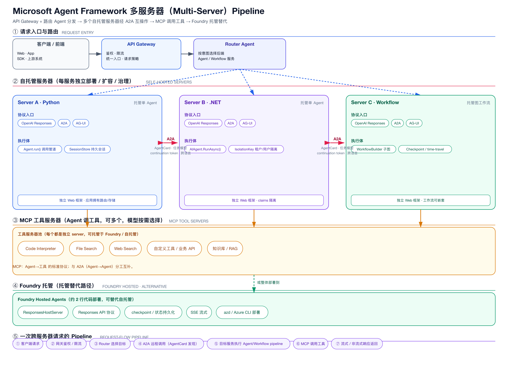

# 07 · 底座 B：Microsoft Agent Framework（MAF）

> 定位：**生产级 agent 的“决策/编排/协议/治理能力层”**。这是混合架构要借用的部分。

## 1. 四大主能力域 + 五基础块

- **Agents**：单 agent，调工具/MCP，统一 `run/run_stream`。
- **Harness Agent**：长任务“电池全带好”（规划/todo、上下文压缩、文件/记忆、一次性工具审批）。
- **Workflows**：图式（顺序/并发/交接/群聊）+ checkpoint + HITL + time-travel + `as_agent()`。
- **Integrations**：多供应商、托管、协议、生态。
- 五基础块：model clients、session、context providers、middleware、MCP clients。

## 2. 对混合架构最有价值的四项

1. **Workflow.as_agent()**：把图工作流当 agent 用 → 直接对应“复合 agent”。
2. **Harness / supervisor**：长任务与子任务分派 → 对应“复合 agent 的经理”。
3. **A2A / MCP / AG-UI**：标准协议互操作 → 对应“外部/远端子 agent 与工具接入”。
4. **SessionStore + isolation key**：会话持久化 + 多租户隔离 → 对应“状态与多租户”。

## 3. 托管哲学（重要）

- **helper-first**：MAF **不是** HTTP 服务器，应用拥有路由/鉴权/存储/扩容，框架只做协议翻译 + 可选执行状态。
- 意味着：MAF 可被“塞进”我们的 Ray 世界，作为 agent 决策的实现，而不是取代我们的运行时。

## 4. 能力边界

- 强：单个/少量 agent 的高质量定义、编排、协议、可观测、治理。
- 弱：**没有世界推进、市场撮合、大规模扇入扇出、10⁵ 级 actor 编排**。

## 5. 在混合架构中的角色

- **能力层**：复合 agent 内部编排、统一模型客户端、协议桥、会话/隔离、可观测。
- **不负责**：世界怎么运转（交给 MASim）。

### 图

---

## 6. MAF 的多服务器通信到底怎么处理（回应讨论点 4）

> 关键结论：**MAF 没有“全局消息总线”，也没有内置“网关/注册中心”。多服务器之间靠标准协议 A2A 点对点调用。**

### 6.1 三件事的分工
- **A2A（agent↔agent）**：服务器 A 的 agent 调用服务器 B 的 agent。这是 MAF 处理“多 server 间通信”的主通道。
- **MCP（agent↔工具）**：一个 agent 调用工具/知识/数据，**不是 agent 间通信**。
- **AG-UI / Responses（agent↔人/前端）**：对外暴露给人或前端。

### 6.2 A2A 的机制
- 服务端：把本地 agent 用 `A2AExecutor`（Python）/ `AgentA2AAdapter`（.NET）暴露为带 **AgentCard** 的 A2A 服务。
- 客户端：用 `A2AAgent` 把远端 agent 包成“看起来像本地 agent”。
- 调用：HTTP/JSON-RPC，任务模型（`TASK_STATE_COMPLETED/FAILED`）；长任务用 **A2AContinuationToken**（存 task_id + context_id）续跑/轮询，支持流式。
- 跨语言：Python ↔ .NET 可直接互操作。

### 6.3 多服务器如何“拼起来”（MAF 明确不代劳）
- MAF 是 **helper-first**：你的应用自己拥有**路由、鉴权、存储、扩容**。
- 一个 host 可以同时暴露多种协议（A2A + Responses + AG-UI）。
- 但“哪个请求路由到哪个 server”**没有内置组件**；社区通常自己搭 **API Gateway + Router Agent**，由 router 选后端。

### 6.4 对我们平台的直接含义
| 能力 | MAF 提供 | 我们需要自己做 |
|------|----------|----------------|
| agent↔agent 跨服务器 | A2A 主机/客户端 | — |
| agent↔工具 | MCP | — |
| 人机 | AG-UI | — |
| 同集群高频消息 | 无 | **内部消息总线** |
| 跨服务器路由/发现 | 无（无网关） | **路由/发现/命名空间** |
| 多租户会话隔离 | session + isolation key | 复用 |

> 所以：**通信模块 = “内部消息总线（我们做）+ 协议桥（复用 MAF 的 A2A/MCP/AG-UI）”**。MAF 补齐“标准协议”，但不替代我们的内部总线与路由。
