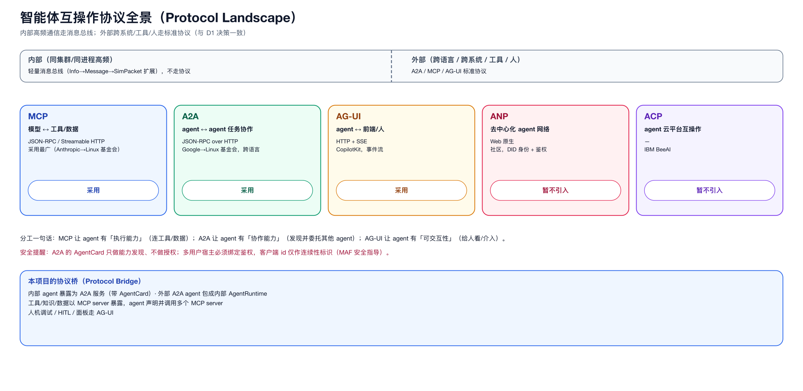

# 14 · 智能体互操作协议（补充）

> 这是“标准、整齐”的协议底座。上一轮只提了 A2A/MCP/AG-UI，这里补全生态，明确各自边界与取舍。

## 1. 协议全景

| 协议 | 发起方 | 定位 | 传输 | 状态 |
|------|--------|------|------|------|
| **MCP** | Anthropic（后入 Linux 基金会） | 模型 ↔ 工具/数据（上下文共享） | JSON-RPC / Streamable HTTP | 采用最广 |
| **A2A** | Google（Linux 基金会） | agent ↔ agent 任务协作 | JSON-RPC over HTTP | 稳步 |
| **AG-UI** | CopilotKit | agent ↔ 前端界面（事件流） | HTTP + SSE | 增长 |
| **ANP** | 社区（开源） | 去中心化 agent 网络（DID） | Web 原生 | 早期 |
| **ACP** | IBM BeeAI | agent 云平台互操作 | — | 早期 |

## 2. 各自解决的问题（一句话）

- **MCP**：让 agent 用统一方式连**文件、数据库、业务系统、工具**——解决“执行能力”。
- **A2A**：让一个 agent **发现并委托**另一个 agent 完成任务——解决“多 agent 协作”。
- **AG-UI**：把 agent 内部事件流标准化给**前端/人**——解决“人机交互”。
- **ANP/ACP**：愿景是“Agent 公网/云”，带身份（DID）与鉴权——解决“跨组织互操作”。

## 3. 对我们最相关的取舍

| 需求 | 用 | 不用 |
|------|-----|------|
| 内部高频 agent↔agent | —（内部总线） | A2A（协议开销） |
| 跨语言/跨服务/外部 agent | A2A | 自造协议 |
| agent 调工具/知识/数据 | MCP | 硬编码 |
| 人机调试/HITL/面板 | AG-UI | 自造前端协议 |
| 去中心化公网 | （暂不需要） | ANP/ACP |

> 这与 **D1 决定**完全一致：内部走总线，外部走 A2A/MCP/AG-UI；ANP/ACP 暂不引入。

## 4. 一个提醒（安全）

- A2A 的 `AgentCard` 只做**能力发现**，不做**授权**；多用户宿主必须绑定鉴权，把客户端提供的 id 限制在“连续性标识”而非“授权令牌”（MAF 的安全指导）。
- 这直接对应我们“多租户隔离”与“外部接入”的安全设计。

## 5. 结论

标准协议生态已足够成熟，**我们不需要自造协议**。需要做的是：
1. 明确“内部总线 vs 外部协议”的边界（已定 D1）；
2. 用一个薄薄的**协议桥**把内部 agent 暴露为 A2A/MCP，把外部 A2A/MCP 包成内部 agent/工具；
3. 在协议桥上落实**鉴权与隔离**。
