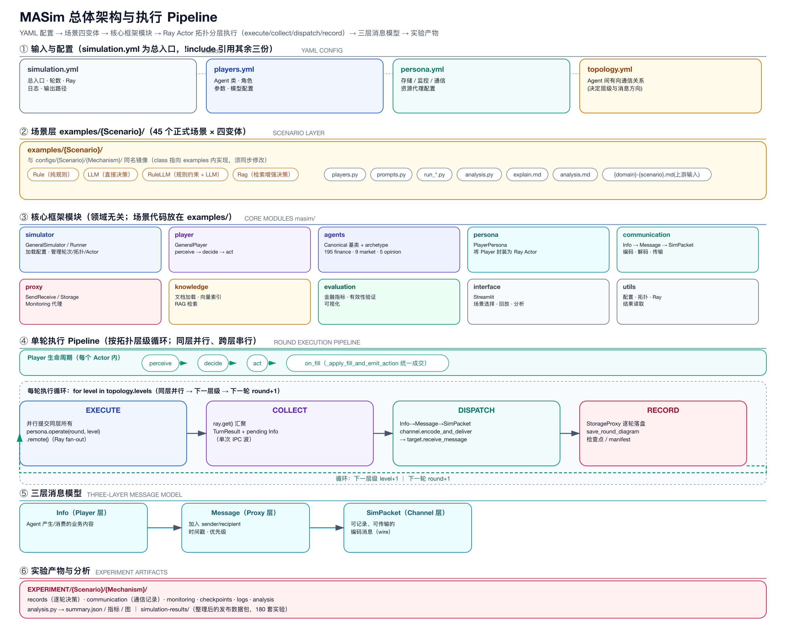
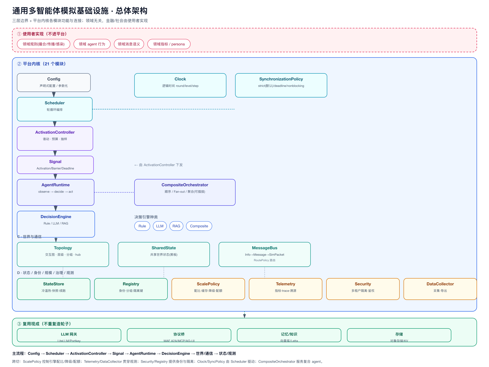
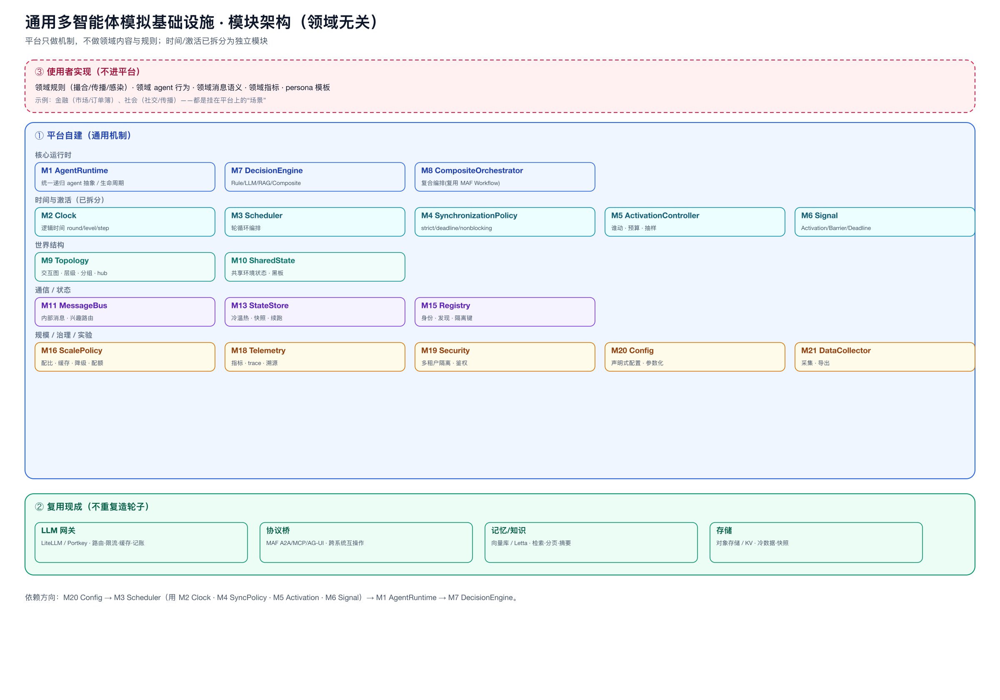
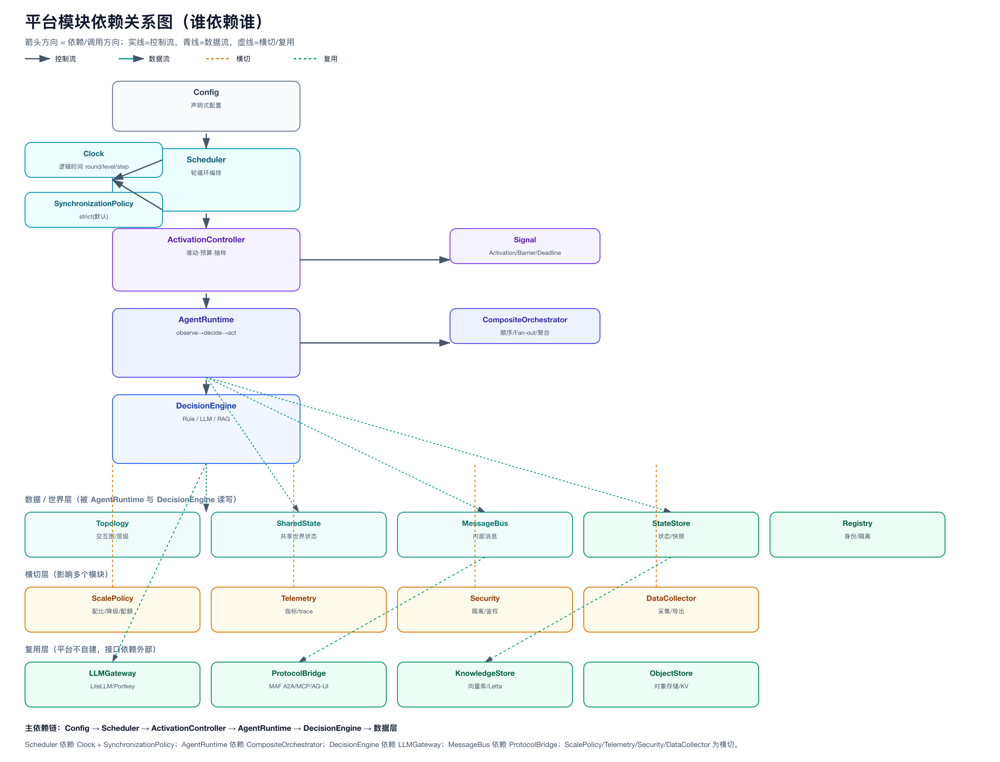
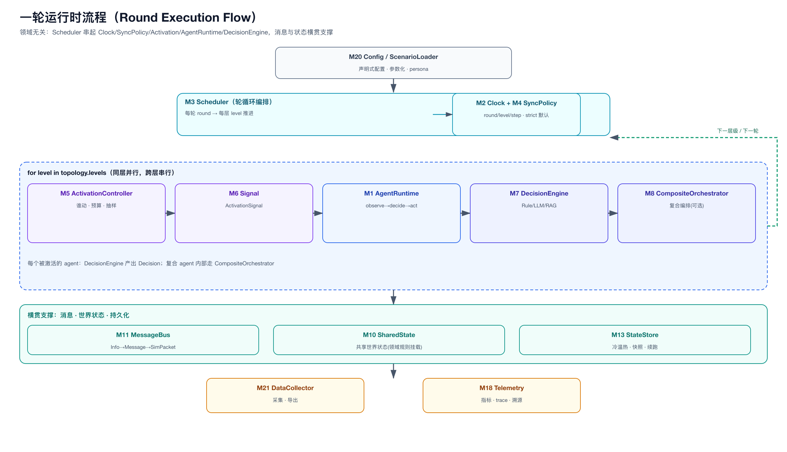
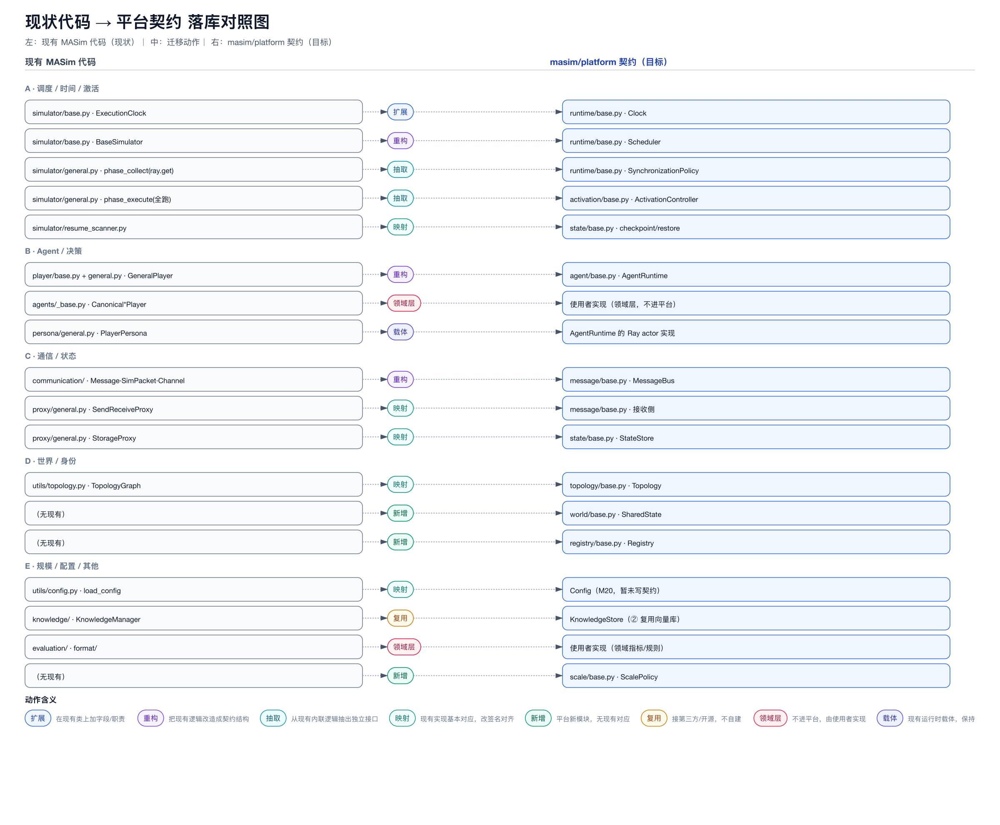
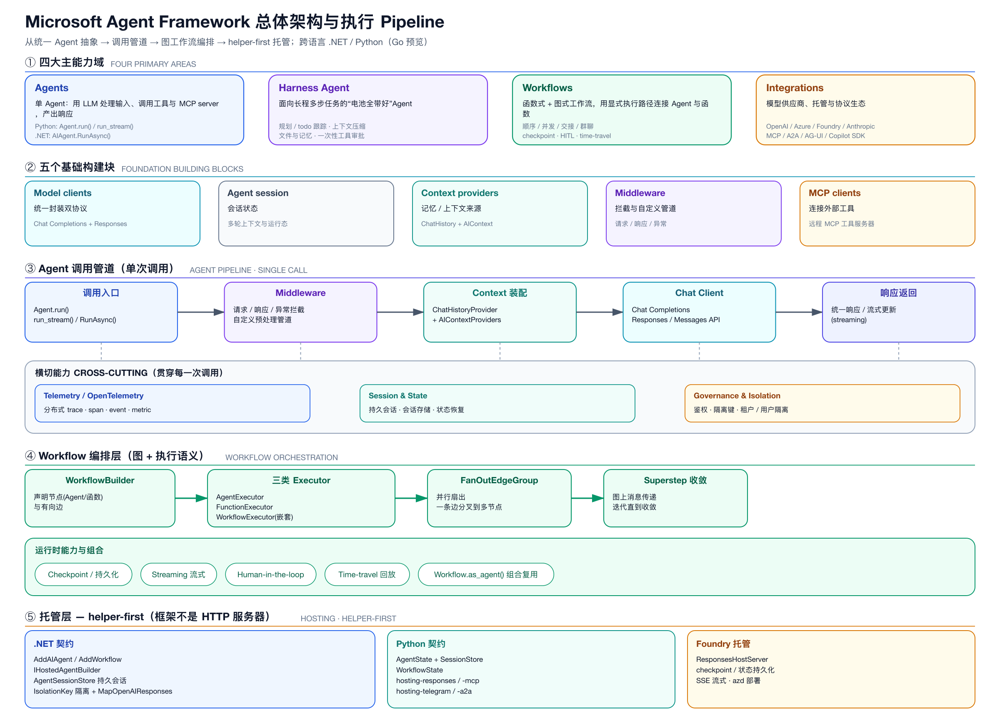

# MASim · 通用多智能体模拟平台（项目结构与当前设计总览）

> 本文是**当前框架的权威总览**：既描述「正在运行的多智能体模拟框架 MASim」，也描述「正在演进的领域无关通用平台设计」（契约层 + 总体架构 + 决策）。
> 设计细节分目录存放：总体架构 `docs/hybrid-design/`、讨论与决策 `docs/hybrid-design/discussion/`、已有工作审查 `docs/hybrid-design/existing-work/`、深入实现参考 `examples/_platform-notes/`。

---

## 0. 当前状态一句话

**MASim 正在从“金融市场多智能体模拟框架”演进为“领域无关的通用多智能体模拟基础设施”。**

- **运行中的部分**（Part 1）：MASim 现有框架，支撑 45 个金融场景、四机制、Ray 分布式、市场撮合、实验产物。
- **设计中的部分**（Part 2）：通用平台契约层 `masim/platform/`（只定义不实现）+ 总体架构 + 10 项核心决策（D1–D10），金融/社会等由使用者实现。

两部分的衔接点在 `docs/hybrid-design/diagrams/migration-mapping.png`：现有代码如何改造成平台契约。

---

# Part 1 · 现有运行框架（MASim）

## 1. 项目定位

MASim 是一个面向金融市场与群体行为研究的多智能体模拟框架。它让不同类型的 Agent 在共享市场中持续感知、决策、行动和通信，用于观察个体行为如何形成价格、成交量、波动率、流动性和信息传播等宏观结果。

仓库当前包含：

- 45 个正式场景（`examples/{Scenario}/`），每个场景四种变体；
- 四种决策机制：`Rule`、`LLM`、`RuleLLM`、`Rag`；
- 标准化实验产物（`EXPERIMENT/` 单次运行）；`simulation-results/` 发布包为**目标（未落地）**，当前仓库中不存在该目录，`EXPERIMENT/` 也**只有 4/45 个场景**留有产物；
- **209** 个通用 Agent 原型（finance 195 + market 9 + opinion 5）+ `masim/agents/defines/` 可复用 Agent 档案库（209 份 Markdown 档案与实现 1:1 镜像）；
- Streamlit 实验回放与分析界面；
- `masim/skills/` 设计/创建/升级 Skill 体系（`define-simulation-scenario-skill.md`、`agent-design-skill.md`、`implement-simulation-skill/`、`create-simulation-pipeline.md`、`polish-simulation-pipeline.md`）。

## 2. 核心执行链

```text
YAML 配置
  -> GeneralSimulator 创建 Ray Actor
  -> PlayerPersona 托管 Player 与基础设施代理
  -> Player 执行 perceive -> decide -> act (-> on_fill)
  -> Communication/Proxy 路由 Agent 消息
  -> Storage 保存逐轮状态和通信记录
  -> analysis.py 计算指标并生成分析产物
```

每轮按拓扑层级执行三阶段：`execute`（同层并行决策）→ `collect`（汇聚结果与待发消息）→ `dispatch`（按拓扑投递）。这三个 `phase_*` 都是**逐层（per-level）**方法（`masim/simulator/general.py:424/458/497`），并**不存在** `phase_record`。所谓“record”是每轮一次的独立代码块，只做两件事：限流绘制拓扑图（`general.py:631`）与 `write_resume_checkpoint`（`general.py:650`）；真正的数据落盘发生在 `operate()` / `receive_message()` 内部。



**Player 生命周期契约**（**目标（未落地）**：「金融场景 Player 由 canonical 基类派生」；以下同时给出「现状」测量）：框架提供的 canonical 基类为 `CanonicalRulePlayer / CanonicalLLMPlayer / CanonicalRagPlayer / CanonicalMarketCoordinator`（`masim/agents/_base.py`），archetype 只覆盖 `on_fill`，**禁止 override `act()/decide()`**。

- 「现状」：180 个 `examples/*/*/players.py` 分为三类——**1 个**（`examples/AnchoringEffect/Rag/players.py`）在文件内声明派生自 `Canonical*` 的类；**4 个**是**组合式（reuse）**薄模块：不声明任何 player 类，而是从 `masim/agents/` 重导出具体 archetype（`AnchoringEffect/{Rule,LLM,RuleLLM}` 与 `TulipMania/Rule`），这是**目标形态**；**175 个**仍直接派生自 `GeneralPlayer`（legacy，待迁移）。因此 `scripts/audit_scenario_contract.py` 的 `STRUCT-ACT`/`STRUCT-DECIDE`/`STRUCT-PERCEIVE` 检查只对 canonical 子类生效，其“0 findings”对 **175 个 legacy 文件**而言是**空转**；审计报告现已打印该迁移进度（`--scope all`）。
- 「现状」：`masim/agents/` 下 **200 个** archetype 实现 `decide_order`，**5 个** override `on_fill`，**0 个** override `act`/`decide`/`perceive`。
- 「现状」：流动性裁剪**不在** `_apply_fill_and_emit_action` 内，而在 `masim/format/finalize.py` 的 `clip_order_to_liquidity`，经 `finalize_rule_order` / `finalize_llm_order` 触达。`_apply_fill_and_emit_action` 自身的职责顺序是：key guard → 正 bid 价 guard → cash/position 变更 → `on_fill` → Action 信封。

完整契约见 `docs/framework-contract.md`。

## 3. 顶层目录（现有）

```text
multiagent-simulation/
|-- masim/                    # 通用模拟框架 + 设计 Skill
|   |-- simulator/  player/  persona/  communication/  proxy/
|   |-- agents/  knowledge/  evaluation/  format/  interface/  utils/
|   |-- skills/
|   `-- platform/             # ★ 新增：平台契约层（见 Part 2）
|-- examples/                 # 场景实现 + _platform-notes/ 深入参考
|-- configs/                  # 场景运行配置
|-- docs/                     # 架构、场景、实验规范
|-- EXPERIMENT/               # 单次运行产物（现状：仅 4/45 个场景有产物）
|-- simulation-results/       # 发布包（目标，未落地：当前不存在）
|-- setup.py  requirements.txt
```

## 4. 框架模块（现有）

| 模块 | 职责 | 主要入口 |
|------|------|----------|
| `masim/simulator` | 加载配置、管理轮次/拓扑/Ray Actor | `GeneralSimulator` / `GeneralSimulationRunner` / `run()` |
| `masim/player` | Agent 感知/决策/行动基类 | `GeneralPlayer` |
| `masim/agents` | 金融 canonical 基类 + archetype | `CanonicalRulePlayer` 等 / `on_fill` |
| `masim/persona` | 将 Player 封装为 Ray Actor | `PlayerPersona` |
| `masim/communication` | 消息编码/解码/传输 | `GeneralCommunicationChannel` / `build_message_from_info` |
| `masim/proxy` | 通信/存储/监控代理 | `SendReceiveProxy` / `StorageProxy` |
| `masim/knowledge` | 文档加载、向量索引、RAG | `KnowledgeManager` |
| `evaluation` | 金融指标、验证、可视化 | `finance/*` |
| `masim/format` | prompt / 订单 schema / 最终化 | `order.py` / `finalize.py` |
| `app` | Streamlit 回放与分析 | `app.py` |
| `masim/execution` | **执行策略**（默认 `SelfFillModel`、示例 `MarketPriceFillModel`） | `FillModel` |
| `masim/player/portfolio.py` | **账本唯一变更入口** | `Portfolio.apply_fill()` |
| `masim/simulator/metrics.py` | **规模化观测**（阶段耗时/RPC/消息/扇出/内存） | `RunMetrics` / `monitoring/run_metrics.json` |
| `masim/world/shared_state.py` | **共享世界状态**（版本提交 + 作用域 + 快照） | `VersionedSharedState` / `world/world_state.json` |
| `masim/agents/_base.py` MarketPerceptionMixin | **按来源的市场感知**（多市场必需） | `market_data_for(source_id)` |
| `masim/platform/execution/base.py` | 执行/结算**契约**（只定义） | `OrderIntent` / `Fill` / `FillModel` |
| `masim/utils` | 配置、拓扑、Ray、结果读取 | `load_config` / `load_results` / `TopologyGraph` |

## 5. 场景与机制

四种机制：`Rule`（纯规则）、`LLM`（大模型直接决策）、`RuleLLM`（规则约束 + LLM）、`Rag`（检索增强）。

场景目录：`examples/{Scenario}/` 含 `{domain}-{scenario}.md`（上游目标说明）、`simulation-bases.md`、`analysis-bases.md`、`{Mechanism}/`；配置在 `configs/{Scenario}/{Mechanism}/`（`simulation.yml` 经 `!include` 引用 `players.yml`/`persona.yml`/`topology.yml`）。

- 45 个场景均具备 `simulation-bases.md` + `analysis-bases.md`，但**有 3 个缺少** `{domain}-{scenario}.md` 目标文件：`examples/HerdingInformation/`、`examples/HindsightBias/`、`examples/MentalAccounting/`。
- 变体目录并非统一四件套：`Rule` 变体**没有** `prompts.py`，因此 “`players.py`/`prompts.py`/`run_*.py`/`analysis.py`” 的写法对 180 个变体目录中的 **45 个不成立**；`prompts.py` 只出现在需要提示词的 `LLM`/`RuleLLM`/`Rag` 变体中。

## 6. 消息与状态

三层消息模型：`Info`（Player 业务内容）→ `Message`（加 sender/recipient/时间/优先级）→ `SimPacket`（可记录可传输的编码包）。所有节点都是 Player；`role: coordinator` 表达协调职责，执行先后与通信方向由 `topology.yml` 决定。

## 7. 实验产物 / 运行入口 / 测试

- 产物：`EXPERIMENT/{Scenario}/{Mechanism}/`（records/communication/monitoring/analysis）。**现状**：`checkpoints/` 与 `logs/` 虽被文档记录，但代码从未创建（`auto_checkpoint` 不被任何代码读取）；`simulation-results/` 发布包**不存在**；`EXPERIMENT/` 目前**只有 4/45 个场景**留有产物。读取用 `masim.utils.load_results()`。
- 「目标（未落地）」：`simulation-results/` 作为统一发布包，待产物流水线落地后补齐。
- 运行：`python examples/{Scenario}/{Mech}/run_*.py -c configs/{Scenario}/{Mech}/simulation.yml`；界面 `streamlit run app/app.py`。
  - **续跑策略（fail-loud）**：`setting.record_path` 中若已有完成轮次，默认**拒绝启动**并提示二选一——`--resume`（从已完成轮次 +1 继续；**agent 状态按配置重置**，不从磁盘恢复）或 `--fresh`（删除上一轮的 `records/` `communication/` `monitoring/` `checkpoints/` 后从第 1 轮重跑）。两者互斥。
  - **产物完整性**：per-agent 记录（`records/<player>/{messages,turns}/`）与 wire 级记录（`communication/`）统一改用「轮次 + 轮内序号」键 `msg_r{round:06d}_{seq:06d}` / `turn_r{round:06d}_{seq:06d}`，不再使用秒级墙钟键。旧键会让同一 agent 在同一秒内的多条记录互相覆盖（`BlockBasedStoreManager` 的重复键语义是 update，不是 add）；序号键同时保证 `--resume` 的新进程不会覆盖上一轮的记录。
  - **入向轮次标注**：per-agent 入向记录使用**消息自身的**轮次（`Message.extras["round_num"]`），而不是接收者的 `current_round`。level>0 的 agent 在其本轮 `operate()` 之前就收到广播，旧实现会把入向记录标成上一轮（首轮标成 round 0）。
  - **引导轮（bootstrap round）**：`is_received_ready` 对 level 0 的“不等前驱”豁免，从硬编码的 `round_num == 1` 改为**本次进程执行的第一轮**（Simulator 通过 `bootstrap=True` 下发）。否则 `--resume` 从第 N 轮启动时，level 0 会因等待尚不存在的入向消息而硬失败（`masim/player/general.py`）。
  - **可选后端**：`import masim` 与契约审计**不需要** `lmbase`；只有真正落盘记录时才需要（缺失时给出带安装指引的 `ImportError`，见 `masim/utils/store_backend.py`）。
- 测试：两套，各司其职。
  - `tests/`（单元，快速）：`PYTHONPATH=. python3 -m unittest discover -s tests -t tests -p "test_*.py"`
  - `examples/uTests/<Part>/`（**按平台部分划分的验收测试**，每部分一个模块）：`PYTHONPATH=. python3 -m unittest discover -s examples/uTests -t . -p "test_*.py"`
  - 依赖 `lmbase` 的用例在缺失时自动 skip；`examples/uTests/` 需要 `.gitignore` 的 `!examples/uTests/` 白名单（`*TEST*` 规则会吃掉它）。
- 契约审计：`python scripts/audit_scenario_contract.py --scope {all|scenarios|archetypes}`；CI 对 `AnchoringEffect` 与 archetype 库**强制门禁**，对其余场景语料仅记录基线。
- 验收三层：运行成功 → 结构成功 → 场景有效（复现目标机制）；进程 `SUCCESS` ≠ 场景有效。

## 8. Agent 档案与复用

`masim/agents/defines/` 是可复用 Agent 档案库（finance/market/opinion，共 **209** 份 Markdown 档案：finance 195 / market 9 / opinion 5），与 `masim/agents/<domain>/` 下的 `.py` 实现 1:1 镜像（按域做 kebab→snake 归一对应）；新场景先做“复用 vs 新建”三段式匹配。

---

# Part 2 · 平台演进设计（领域无关通用基础设施）

> 这是当前正在推进的设计。**平台 = 领域无关的通用多智能体模拟运行时；金融/社会由使用者实现（D3）。**

## 9. 定位与三层边界

**平台只做“机制”，不做“内容与规则”。** 三层：

- **① 平台自建**：通用机制（agent 抽象、时钟、激活、通信、状态、规模、观测）。
- **② 复用现成**：LLM 网关（LiteLLM/Portkey）、协议桥（MAF A2A/MCP/AG-UI）、向量库、对象存储。
- **③ 使用者实现**：领域规则（撮合/传播/感染）、领域 agent 行为、领域消息语义、领域指标、persona。



## 10. 21 个平台模块（M1–M21）



| 组 | 模块 |
|----|------|
| 核心运行时 | M1 AgentRuntime · M2 Clock · M3 Scheduler · M4 SynchronizationPolicy · M5 ActivationController · M6 Signal · M7 DecisionEngine · M8 CompositeOrchestrator |
| 世界结构 | M9 Topology · M10 SharedState |
| 通信 | M11 MessageBus · M12 ProtocolBridge(②) |
| 状态 | M13 StateStore · M14 KnowledgeStore(②) · M15 Registry |
| 规模 | M16 ScalePolicy · M17 LLMGateway(②) |
| 治理 | M18 Telemetry · M19 Security/Isolation |
| 实验 | M20 Config · M21 DataCollector |

### 10.1 模块依赖关系（谁依赖谁）



依赖方向：**A → B 表示 A 依赖/调用 B**。四类依赖：

| 模块 | 依赖（调用/使用） | 被谁依赖 | 类型 |
|------|------------------|----------|------|
| Config | — | Scheduler | 控制 |
| Clock | — | Scheduler | 控制（读时间） |
| SynchronizationPolicy | — | Scheduler | 控制 |
| Scheduler | Clock · SyncPolicy · ActivationController · AgentRuntime | Config | 控制 |
| ActivationController | ActivationPolicy(实现) · Signal | Scheduler | 控制 |
| Signal | — | ActivationController · Scheduler | 数据 |
| AgentRuntime | DecisionEngine · CompositeOrchestrator · MessageBus · SharedState · StateStore · Topology · Registry | Scheduler | 控制+数据 |
| CompositeOrchestrator | Aggregator(实现) · 子 AgentRuntime | AgentRuntime | 控制 |
| DecisionEngine | LLMGateway(复用) · KnowledgeStore(复用) | AgentRuntime | 控制+复用 |
| Topology | — | Scheduler · MessageBus | 数据 |
| SharedState | — | AgentRuntime · DecisionEngine | 数据 |
| MessageBus | Topology · Registry · ProtocolBridge(复用) | AgentRuntime · Scheduler | 数据 |
| StateStore | ObjectStore(复用) · KnowledgeStore(复用) | AgentRuntime | 数据 |
| Registry | IsolationKey | MessageBus · StateStore · Security | 数据 |
| ScalePolicy | — | ActivationController · DecisionEngine | 横切 |
| Telemetry | — | 所有模块 | 横切 |
| Security | Registry · StateStore | MessageBus · ProtocolBridge | 横切 |
| DataCollector | StateStore · Telemetry | 使用者/控制面 | 横切 |

**主依赖链**：`Config → Scheduler → ActivationController → AgentRuntime → DecisionEngine → 数据层`。
**关键横切**：`ScalePolicy` 控制「谁动/用哪种引擎/降级/配额」；`Telemetry/DataCollector/Security` 贯穿观测与隔离；`DecisionEngine` 复用 LLMGateway，`MessageBus` 复用 ProtocolBridge。

## 11. 一轮运行时流程



```text
Config(M20) → Scheduler(M3) 推进一轮 round
  ├─ Clock(M2) 标记 round/level/step（逻辑时间，非墙钟）
  ├─ SynchronizationPolicy(M4) 决定“怎么等”（默认 strict）
  ├─ 对每个拓扑层级 level：
  │     ActivationController(M5) 判定“谁动”，下发 ActivationSignal(M6)
  │     AgentRuntime(M1) → DecisionEngine(M7) Rule/LLM/RAG/Composite(M8) 产出决策
  │     MessageBus(M11) 按 Topology(M9) 投递 → StateStore(M13) 落盘
  └─ SharedState(M10) 更新共享世界状态（领域规则由使用者挂载）
→ DataCollector(M21) 采集 · Telemetry(M18) 观测
```

## 12. 契约层 `masim/platform/`（只定义不实现）

依据《框架实现规定》`docs/hybrid-design/FRAMEWORK-IMPLEMENTATION-RULE.md`：每个模块一个 `base.py`，只含 **ABC + `@abstractmethod` + dataclass + 类型标注 + 文档**，方法体为 `...`；实现类继承 base 并按场景增强。改 base = 改契约，须走 `discussion/02-decisions-log.md`。

| 契约文件 | 定义内容 |
|----------|----------|
| `agent/base.py` | `AgentRuntime`（observe/decide/act/on_fill/children/aggregate）、`Decision`、`Action` |
| `decision/base.py` | `DecisionEngine`、`EngineKind`、`DecisionContext` |
| `composite/base.py` | `Aggregator`、`CompositeOrchestrator`、`ChildResult` |
| `activation/base.py` | `ActivationController`、`ActivationPolicy`、`ActivationSignal/BarrierSignal/DeadlineSignal` |
| `runtime/base.py` | `Clock`、`LogicalTime`、`SynchronizationPolicy`、`Scheduler` |
| `message/base.py` | `MessageBus`、`Info/Message/SimPacket`、`RoutePolicy` |
| `state/base.py` | `StateStore`、`Checkpoint` |
| `topology/base.py` | `Topology`、`Edge` |
| `world/base.py` | `SharedState`、`WorldVersion` |
| `registry/base.py` | `Registry`、`IsolationKey` |
| `scale/base.py` | `ScalePolicy`、`CachePolicy`、`DegradationPolicy`、`Quota/Usage` |

## 13. 关键决策 D1–D10

| # | 结论 |
|---|------|
| D1 | 内部通信走总线；跨系统/外部/工具才走 A2A/MCP/AG-UI |
| D2 | 复合 agent：递归嵌套 + 聚合可插拔 |
| D3 | 平台无任何领域层；金融/社会由使用者实现 |
| D4 | 逻辑时间（round/level），不模拟墙钟；低频决策/高频执行 + 截止降级 |
| D5 | 激活 = 独立模块 ActivationController + ActivationSignal |
| D6 | 平台只定义时钟/信号/同步策略接口；等待/异步是使用者策略 |
| D7 | 时间/激活拆成 Clock/Scheduler/SyncPolicy/Activation/Signal 五模块，最小改造 |
| D8 | Signal 与 Activation 同域 `masim/activation/`；SyncPolicy 默认仅 strict |
| D9 | 契约规定（base.py 只定义不实现）+ 契约包 `masim/platform/` |
| D10 | 4–6 按推荐定案：ProtocolBridge 不写 base.py；MessageBus 最简；A2A 鉴权强制；复合 `max_depth=4/max_children=32/max_total=1024`；聚合「统计 + LLM 摘要」；Composite 顺序 + Fan-out；补评估基准与 MoA |

完整决策记录与讨论：`docs/hybrid-design/discussion/02-decisions-log.md`。

## 14. 现状代码 → 平台契约 落库对照



关键结论：**大部分是“重构/抽取/映射”，不是重写**；真正新增只有 `SharedState`、`Registry`、`ScalePolicy`；明确不进平台的有 `Canonical*Player`、`evaluation/`、`format/`（领域层）；复用 `knowledge/`（向量库）与协议桥（MAF）。

映射细节见 `docs/hybrid-design/discussion/11-module-refactor-mapping.md`。

## 15. 深入实现参考

`examples/_platform-notes/`（**10 篇编号笔记（01–10）+ 1 份 README**，只含文档不含代码）：
`01` 规模化与混合引擎 · `02` 分布式执行 · `03` 市场微观结构 · `04` 金融 LLM agent · `05` 记忆-反思-规划 · `06` 编排范式 · `07` 协议与互操作 · `08` 传统 ABM/GPU · `09` 评估基准与推理增强 · `10` 总映射表（论文→机制→模块→实现要点）。

## 16. 与 Microsoft Agent Framework（MAF）的关系

- MASim 提供**世界侧**（时间/市场/拓扑/消息/状态/Ray）。
- MAF 提供**能力侧复用**：A2A/MCP/AG-UI 协议桥、Workflow/Harness 复合编排、Session/Isolation、Telemetry 思想。
- 二者缺口互补、不重叠：MAF 不管“世界推进与大规模扇入扇出”，MASim 不管“标准协议互操作与生产治理”。



## 17. 文档索引

**分工**：本文 = 仓库地图（目录/模块/场景/命令）；`docs/design/` = 设计原理与运行时细节（含图集）；`docs/framework-contract.md` = Player 逐条契约；`docs/hybrid-design/` = 演进设计。

| 内容 | 位置 |
|------|------|
| **设计总纲（为什么这样设计 + 能力现状矩阵）** | `docs/design/README.md` |
| **架构与运行时细节（11 张图）** | `docs/design/architecture.md` |
| **Player 生命周期契约** | `docs/framework-contract.md` |
| 设计图集 | `docs/design/diagrams/` |
| 工作约定（提交规则 / 验收门槛 / 代码约定） | `AGENTS.md` |
| 总体架构（收敛版） | `docs/hybrid-design/ARCHITECTURE.md` |
| 框架实现规定 | `docs/hybrid-design/FRAMEWORK-IMPLEMENTATION-RULE.md` |
| 决策记录 D1–D10 | `docs/hybrid-design/discussion/02-decisions-log.md` |
| 平台模块清单 | `docs/hybrid-design/discussion/07-platform-modules.md` |
| 落库映射 | `docs/hybrid-design/discussion/11-module-refactor-mapping.md` |
| 已有工作审查 | `docs/hybrid-design/existing-work/README.md` |
| 深入参考 | `examples/_platform-notes/README.md` |
| 契约代码 | `masim/platform/*/base.py` |

---

> 建议阅读顺序：先读设计总纲 `docs/design/README.md`（原则与取舍）→ 再看图 `docs/design/architecture.md`（运行时细节）→ 再看本文（仓库地图）→ 改造代码前读 `docs/framework-contract.md` → 推进平台演进读 `docs/hybrid-design/`。
